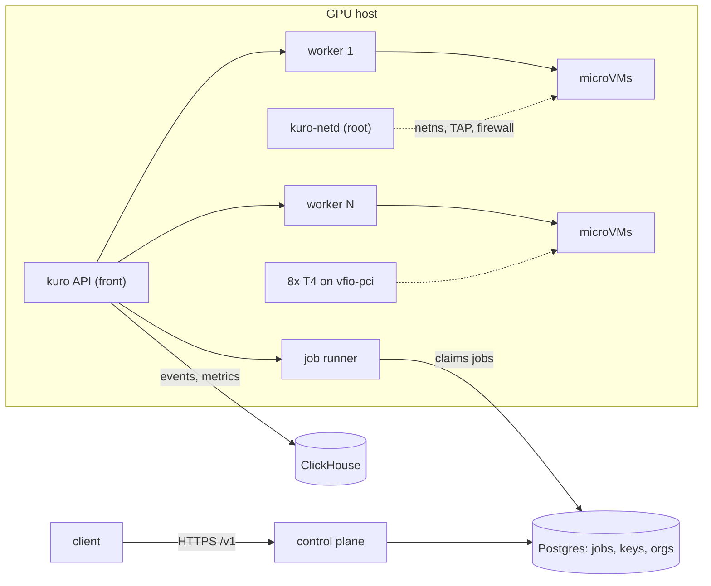

# Intro

Hey, how's it going ? Hope you're doing well. \
Last time i wrote about running Firecracker nested on a MacBook and getting 8 clones down from 160 seconds to about one ([that one is here](/blogs/firecracker-nested-restores/)).
While doing that, i kept reading Firecracker's source more than i was running it. At some point the question just became: what if i write the VMM myself. So i did. It's called **kuro**.

<!-- TODO(briheet): a line or two in your own words on why you started it. -->

kuro is a microVM runtime in Rust, on top of KVM. It takes code i didn't write, runs it in its own VM with its own kernel, and if the job needs a GPU, the VM gets a whole one. By the end of this post it:

- goes from an API request to a root login in **~1.7 s**, from a kernel and image i built myself;
- passes **whole GPUs** to VMs with VFIO, and scrubs them between tenants;
- runs **1,093 VMs on one host**, restored from snapshots instead of booted;
- finishes **~1,586 jobs a second** on one host, and **26.9 GPU jobs a second on 8 T4s**.

It went from an empty repo on Oct 24 to those numbers about ten days later.

I kept a log of every change while building it. 23 entries, every number measured, every wrong guess written down. This post goes through that log in order: what i built, why, how it works underneath, what broke and what i measured. If you want to build your own GPU microVMs, you should be able to follow along piece by piece. I explain the theory as i go: what KVM actually does, why a page fault costs more inside a VM, what VFIO is, why a lock you only read still hurts, why Postgres can pile up on a plain insert. If you know these already, skip ahead, the numbers are in the tables.

Disclaimer, this one is long. Like, really long. Grab two coffees this time :sob:

# Why i built it

The problem kuro solves is simple to say. It runs code nobody on the host wrote: jobs, agents, notebooks, model inference. Some of it needs a GPU. Any of it may be hostile. That code needs three things at once:

1. **A real boundary.** A tenant must not reach the host, or another tenant.
2. **Speed.** Most jobs are short. If the boundary takes seconds to set up, it costs more than the job itself.
3. **GPUs.** They're scarce and expensive, so they have to be shared over time, without anything leaking between tenants.

Every usual answer gives up one of these:

| Option | What you get | What you give up |
|---|---|---|
| Containers | fast | every tenant shares the host's kernel, and its GPU driver with it |
| Full VMs (QEMU and friends) | a real boundary | boot in seconds, and carry a lot of emulated hardware |
| Forwarding GPU calls to one driver (gVisor's nvproxy) | sharing | every tenant sits behind the same host driver |
| Splitting a GPU in hardware (MIG) | sharing | only some GPUs have it, and it needs a licence inside VMs |

So my plan was to put **every job in a microVM on KVM, with as little in it as possible.** In more words:

- **Hardware isolation.** Each VM has its own kernel, and the CPU and the IOMMU enforce the boundary. There's no big shared kernel in the middle.
- **My own VMM.** I used Firecracker as a reference and didn't fork it. I reuse the rust-vmm crates (`kvm-ioctls`, `vm-memory`, `linux-loader`, `vm-superio`, `virtio-queue`), but the device model, the PCI layer, the GPU device and the process model are kuro's.
- **A whole GPU, or none.** A GPU VM owns one GPU through VFIO. Between tenants, the host scrubs it.
- **Never boot twice.** Boot once, snapshot, restore everything else from that.
- **The host only runs work.** Keys, queues and placement live in a control plane. A GPU host runs VMs and nothing else.

Why not just use Firecracker then? Two reasons. Firecracker has no GPU support (no PCI at all, by design), and it runs one VM per process with a jailer around it. That's a great design, and i wanted to try a different one. I also wanted to own every decision and know why each one is there. And honestly, i wanted to learn how this stuff works from the bottom, and writing it was the way i'd actually learn it.

# What i used

Here's the kit, so you can read every number in this post against it. The GPU pieces only come in much later.

**A Linux host with KVM.** Everything sits on `/dev/kvm`. On x86 that needs VT-x or AMD-V, on arm64 a host kernel running at EL2. I checked access like this:

```
ls -l /dev/kvm        # crw-rw---- root kvm ...
id                    # am i in the kvm group?
```

**An IOMMU and a PCI GPU, for passthrough.** VFIO needs the IOMMU on (Intel VT-d on my box), so the GPU's DMA goes through page tables the host controls. An empty `/sys/kernel/iommu_groups/` means there's no IOMMU. The GPU also has to be one the host can unbind from its driver and bind to `vfio-pci`, ideally in its own IOMMU group. I used AWS's **`g4dn.metal`** with 8× NVIDIA T4. It has to be the `.metal` size; a normal cloud VM doesn't give you a GPU you can pass through again.

**Rust**, stable. kuro is a Cargo workspace, and only the VMM crate may use `unsafe`.

**Nix.** The guest kernel and image are built with Nix and NixOS. Any other way of building a Linux guest works too, but some of the problems below are Nix ones, and some of the tricks (erofs store packing, the `perlless` profile) come from NixOS.

**A dev machine.** I write code on an Apple Silicon MacBook. KVM runs inside a NixOS VM in Lima (`kuro-dev`), which means **nested virtualization**: my guests are VMs inside a VM. That works, with two catches. Every VM exit crosses two hypervisors, so exits cost about 100× more than on bare metal and boot times look much worse than on real hardware. And a nested dev VM has no IOMMU (GitHub's runners don't either), so VFIO can't be tested there at all.

| Layer | What |
|---|---|
| Dev machine | MacBook (Apple Silicon). aarch64 KVM inside a NixOS VM in Lima (`kuro-dev`), so **nested virtualization**, the same pain as last post |
| x86_64, before real hardware | GitHub's CI runners, which have `/dev/kvm` |
| Production host | AWS **`g4dn.metal`**: 96 vCPUs (Cascade Lake), 377 GiB, **8× NVIDIA T4**, Linux 7.0, 2 NUMA nodes. I'll call it t4gpu from here |
| Guest | NixOS built with Nix, my own kernel config |
| Load and profiling | k6, `perf`, `strace -T`, `pg_stat_statements`, `top -H`, and a lot of small samplers |

One rule i kept for the whole project: measure first, change one thing, measure again. You'll see me break it a few times, and every time i did, i was wrong.

# How KVM runs a VM

Before anything else, the basics, coz everything after leans on them.

When you run a VM on Linux, the CPU does most of the work. Intel calls it VMX, arm calls it EL2, the idea is the same: the CPU has a mode where it runs guest code directly, at full speed, until the guest does something it isn't allowed to do on its own. Then the CPU stops the guest and hands control back to the host. That's called a **VM exit**.

**KVM** is the Linux kernel module that drives that hardware. It doesn't emulate devices, it doesn't load kernels, it doesn't know what a disk is. It gives you a file, `/dev/kvm`, and a set of ioctls on it:

```
open("/dev/kvm")                    -> the KVM system fd
ioctl(KVM_CREATE_VM)                -> a VM fd
ioctl(vm, KVM_SET_USER_MEMORY_REGION)   "guest address X is backed by host memory Y"
ioctl(vm, KVM_CREATE_VCPU)          -> a vCPU fd
mmap(vcpu fd)                       -> the kvm_run struct, shared with the kernel
ioctl(vcpu, KVM_RUN)                runs the guest until it exits
```

That's most of what it takes to boot something. Everything else is the **VMM**'s job, the virtual machine monitor, the userspace program. QEMU is a VMM. Firecracker is a VMM. kuro is a VMM. A VMM:

- allocates the guest's RAM and tells KVM about it;
- loads the kernel and whatever the kernel needs to find its way (a device tree on arm, `boot_params` on x86);
- sets up each vCPU's registers so it starts in the kernel's entry point;
- runs one thread per vCPU that calls `KVM_RUN` in a loop;
- emulates devices: when the guest touches a device's address, the vCPU exits, and the VMM decides what that read or write means.

So the heart of every VMM is a loop like this one:

```rust
loop {
    match vcpu.run()? {
        VcpuExit::MmioRead(addr, data)  => bus.read(addr, data),   // guest read a device register
        VcpuExit::MmioWrite(addr, data) => bus.write(addr, data),  // guest wrote one
        VcpuExit::IoIn(port, data)      => io_bus.read(port, data),   // x86 only: in/out ports
        VcpuExit::IoOut(port, data)     => io_bus.write(port, data),
        VcpuExit::Shutdown | VcpuExit::SystemEvent(..) => break,
        other => handle(other),
    }
}
```

The important thing here: **an exit is expensive.** The CPU saves the guest's state, loads the host's, runs host code, then does it all in reverse. On bare metal that's somewhere around a microsecond or two, plus whatever the VMM does. Under nested virtualization, where the "host" is itself a VM (like my Mac dev setup), every exit crosses two hypervisors, and it costs on the order of **100–200 µs**. Keep this in mind, coz most of the boot-time work below is me learning it the hard way.

Some exits never reach the VMM at all. KVM handles them in the kernel: a page fault on guest RAM that isn't mapped yet (on Intel that's an **EPT violation**, EPT being the second level of page tables that maps guest physical to host physical), a timer, an interrupt. Those are cheaper, but still not free.

Devices are the other half. Real hardware is complicated, so VMs use **virtio**, a standard for devices made to be virtual. A virtio device is a few registers plus **queues** (rings) that live in guest memory. The guest puts buffers on a queue and writes to a "notify" register. The device takes buffers off, fills them, puts them on the "used" ring and raises an interrupt. The guest's `virtio_blk` or `virtio_net` driver does the rest. Most of the device work, then, is: read the ring out of guest memory, do the I/O, write the results back.

That's enough theory to start. Here's the whole thing first, then i'll go through how i built it.

# The overall design

This is what kuro looks like at the end of this post. Don't worry if parts of it mean nothing yet, every box gets its own section.



- **The VMM** (`src/vmm`) runs a microVM: KVM, guest RAM, vCPUs, devices, VFIO, snapshots and resets.
- **The host API** runs many VMs on one machine over a Unix socket, spread over worker processes (why it needs workers is a whole section later).
- **The guest** is my own Linux kernel and a NixOS image, built with Nix. Every VM shares one read-only store. A small agent inside runs commands for the host over vsock.
- **The job queue** is Postgres. Hosts claim jobs, only as many as they have room for.
- **Networking** goes through `kuro-netd`, a small root helper. The VMM itself runs unprivileged.

And the life of a job at the very end:
1. A client sends `POST /v1/jobs` with a script and gets `202` and an id.
2. The control plane checks the key and the org's caps, and inserts the job.
3. A host's runner claims it, if the org has room and the host has a slot.
4. The host takes a VM from the org's pool, or restores one from a template snapshot.
5. The agent in the guest runs the script and sends back the exit code and output.
6. The VM is reset to the snapshot for the org's next job. Only the pages that changed get copied back.
7. The client's `GET /v1/jobs/{id}/wait` returns.

I built it bottom up, in the order this post goes: one VM that boots, then the plumbing around it, then the GPU, then lots of VMs, then real jobs.

# Booting a VM

This chapter goes from an empty repo to a VM that boots to a root login in 1.7 s, on arm64 and then x86_64.

## The guest image

A VMM doesn't run "an OS". It loads a few files into guest memory and jumps to the kernel. That's it. Those files are:

| Part | What it is | Who reads it |
|---|---|---|
| **kernel** | the guest's Linux (`Image` on arm64, `bzImage` on x86_64) | the VMM loads it into memory |
| **initrd** | an optional small filesystem in RAM, the first userspace, which prepares the real root | the kernel unpacks it |
| **root filesystem** | the OS itself: binaries, libraries, config | the kernel or initrd mounts it from a disk |
| **cmdline** | kernel parameters: `init=…`, `console=…`, `panic=1` | the kernel parses it |

So the very first thing i needed, before writing a single KVM call, was a guest image. I started where any NixOS person would: a stock NixOS netboot build. It booted under QEMU in about 17 s, which sounded fine until i looked at what was in it:

| Part | Size |
|---|---|
| kernel | 68 MB |
| initrd | 329 MB (the whole system: a squashfs of the Nix store, inside the initrd) |
| closure | 445 store paths, ~1005 MiB |

And the biggest things in that closure:

| Item | MiB |
|---|---|
| `linux` | 194.7 |
| `linux-modules` | 117.5 |
| `systemd` | 58.9 ×2 |
| `perl` | 56.7 |
| `glibc` | 44.8 |
| `icu4c` | 39.6 |
| `boost` | 17.5 |
| `hwdb.bin` | 13.2 |

A microVM needs almost none of it. There's no hardware to probe, so no module tree and no hardware database. No Perl. Why is there boost in my VM :sob:

### The guest kernel config

My first try was taking Firecracker's 6.18 microVM kernel config and merging a small fragment of mine on top. It worked: 1349 options built in, 0 modules. But it was someone else's 98 KB config, tuned for Amazon Linux, and i couldn't tell you what half of it did. I wanted to know and own every option. So i threw it away and went the other way round:

1. Linux 6.18 LTS source from nixpkgs.
2. **`make allnoconfig`**, which turns *everything* off, with `KCONFIG_ALLCONFIG` pointing at a file of the only options i want on. The kernel then has exactly what i wrote down and nothing else:

   ```
   make allnoconfig KCONFIG_ALLCONFIG=kuro.config
   ```

3. Each architecture's list is a Rust const, grouped by why each option is there: core, boot, what systemd needs, network and vsock, virtio-mmio, serial, filesystems, plus the arch ones (EFI and DMI on arm64; 64-bit, KVM guest, x2APIC, ACPI on x86_64). What ends up in the file is plain kconfig:

   ```
   CONFIG_VIRTIO_MENU=y
   CONFIG_VIRTIO_MMIO=y
   CONFIG_VIRTIO_BLK=y
   CONFIG_MISC_FILESYSTEMS=y
   CONFIG_EROFS_FS=y
   ```

4. **A dependency check.** kconfig *silently drops* an option whose dependencies aren't met. I asked for `EROFS_FS`, didn't get it, and nothing told me. So the build re-reads the final `.config` and fails if anything i asked for is missing. It caught two real mistakes on day one: `EROFS_FS` needs the `MISC_FILESYSTEMS` menu, and every `VIRTIO_*` needs `VIRTIO_MENU`. It kept catching things later too: a kernel bump dropped `CONFIG_VMGENID` with an "unmet dependency", and this check is what told me.
5. **No module support at all, `MODULES` off.** Every driver is built in. This is also a security thing: an untrusted guest can't load code into its own kernel if the kernel has no module loader.

| | Firecracker-based config | My config | Old NixOS kernel |
|---|---|---|---|
| Options built in | 1349 (arm64) | **641** (arm64), **695** (x86_64) | thousands, plus modules |
| Kernel image | – | **8.7 MB** arm64 `Image`, **4.2 MB** x86_64 `bzImage` | 68 MB |

Getting NixOS to accept a kernel with no modules took some digging. These cost me an evening each:

- **nixpkgs' kernel builder fails on zero modules.** With `MODULES=y` but no modules built, its install step runs `xargs rm` over an empty list, and `rm` with no arguments errors out. Turning `MODULES` off fixed it, and that's what i wanted anyway.
- **NixOS couldn't tell the kernel has no modules.** NixOS leaves the module loader out of its systemd initrd only when the config says `CONFIG_MODULES=n`. But nixpkgs' config reader only keeps `=y` and `=m` lines, and kconfig writes `# CONFIG_MODULES is not set` for an off option. So NixOS always assumed modules exist. The fix is passing the kernel an explicit config attrset with `CONFIG_MODULES = "n"`.
- **My first fix for that silently did nothing.** The parsed config carries its own `isSet`/`isYes` helper functions. Merging my values into it kept the *old* helpers, which shadowed the new values. The fix was copying only the `CONFIG_*` values, then adding mine. Nix laziness is fun like that.
- **NixOS's firewall failed to start** coz the kernel has no netfilter. A firewall *inside* an untrusted guest protects nothing anyway, since the guest controls it. Filtering belongs on the host, so i turned it off.

### A shared read-only store

Next was the root filesystem. I first did what Firecracker does: an ext4 disk with the whole system on it, which the kernel mounts as `/dev/vda` with no initrd. Login went from 12.8 s to 9.9 s. Faster, but it didn't fit what i wanted.

A writable root disk means every VM needs its own 632 MB copy of it. That's slow to start and wastes disk. What i actually cared about was how 100 VMs boot from one build. So the layout became:

| File | Size | Shared? |
|---|---|---|
| `kernel` | 8.7 MB | shared |
| `initrd` | 24 MB | shared; a small systemd initrd that only mounts `/` and the store |
| `store` | 605 MB, **erofs, read-only** | **shared by every VM**, and the host keeps one copy in its page cache |
| `cmdline` | 152 B | shared |
| `/` | tmpfs in guest RAM | per VM, gone when the VM stops |

The store disk is found by its filesystem label (`kuro-store`), so it doesn't matter where the VMM attaches it. The untrusted guest can't change the shared store: the disk is attached read-only, mounted read-only, and Nix is disabled in the guest. And i didn't write the erofs packing myself. NixOS's own `qemu-vm.nix` already packs a store into erofs (`nixos/lib/erofs-store-image.nix`), so i reused it. 3 VMs booted at once from one store file on the first try.

### A boot profile from inside the guest

To know where boot time goes, the guest reports on itself. If the kernel cmdline has `kuro.profile`, a small unit runs once boot finishes and prints `systemd-analyze`, the critical chain, the 20 slowest units and `free -m` to the console. It's a `simple` unit so its own start doesn't hold up "boot finished", which it waits for with `systemctl is-system-running --wait`.

The first profile, still under QEMU in my nested dev VM:

| Phase | Time |
|---|---|
| QEMU start + kernel, until the initrd starts (host clock) | 1.28 s |
| kernel (guest clock) | 0.14 s |
| initrd | 2.96 s, mostly waiting for the store disk (`dev-vda.device`: 3.28 s) |
| userspace until the login prompt's unit starts | 2.95 s |
| host clock at the root login | ~12.2 s |
| `multi-user.target` | **32.9 s**, coz `dhcpcd` waits 30 s for a network card that doesn't exist |

lol. 30 seconds of DHCP for a NIC that isn't there. Also, the QEMU process used 369 MiB, 328 MiB of it guest RAM the guest had touched, and the guest had ~111 MB of page cache. That's double caching: the guest keeps its own copy of store pages the host already has cached. Both of those come back later.

Then i dropped QEMU completely. It was a stand-in to prove the image boots before my own VMM existed, but its device model and startup are QEMU's, so its timings don't carry over. From here on, an image counts as booting when **kuro** boots it.

## The VM config

A quick one before KVM. A **config describes one microVM**: how many vCPUs, how much memory, what to boot, which disks. The VMM reads it and builds exactly that. 100 VMs means 100 configs, all pointing at the same shared kernel, initrd and store.

```rust
pub struct VmConfig {
    pub machine_config: MachineConfig,
    pub boot_source: BootSourceConfig,
    pub drives: Drives,
}

pub struct MachineConfig {
    pub vcpus: VcpuCount,            // 1..=32
    pub memory: MemSize,             // MiB, >= 128, even (splits into 2 MiB huge pages)
    pub cpu_template: Option<Id>,
}

pub struct DriveConfig {
    pub id: Id,                      // 1..=64 of a-z 0-9 - _
    pub path: HostFile,              // must exist
    pub read_only: bool,             // the shared store: true
}
```

Every field is a small type with a `TryFrom` that rejects bad values, and serde's `#[serde(try_from = …)]` routes parsing through those checks. So JSON, env vars and CLI flags all hit the same rules, and if a `VcpuCount` exists, it holds a valid count. `deny_unknown_fields` turns a typo like `vcpu` into an error instead of a silently ignored field. One rule i took from Firecracker's `VmResources`: a section joins the config only when its device exists, so the config never describes something the VMM can't build yet.

## Guest memory

Now the first code that touches `/dev/kvm`.

### The address layout

A guest sees one flat range of physical addresses. Everything lives at some address in it: RAM, the kernel, every device's registers, the interrupt controller, later a GPU's BARs. If those addresses get picked in different files, they eventually overlap, the guest reads a device register where it expected RAM, and the bug looks like corruption somewhere else entirely. So there is one **layout table per architecture**, and it's the only place addresses are decided. Devices never pick their own address, they ask an allocator built from that table.

x86_64 (production) looks like this:

| Range | What |
|---|---|
| 0 – 3 GiB | RAM (real-mode and boot structures need low memory) |
| 3 – 4 GiB | the 32-bit MMIO hole: devices, then the IOAPIC and LAPIC at fixed addresses |
| 4 – 256 GiB | RAM continues |
| 256 – 512 GiB | 64-bit MMIO window (GPU BARs, later) |
| 512 GiB – 1 TiB | past the window: host-file slots, hotplug |

Why the hole at 3 GiB? x86 PCs have always kept the last GiB below 4 GiB for devices, coz 32-bit hardware can only address that far. So x86 RAM is split around it. On arm64 i put devices below RAM and there's no hole at all. I reserved the 64-bit window from the start, even with no GPU yet, since GPU BARs are big and need somewhere to go. The per-arch files hold only constants, and the logic that places RAM around the holes is written once:

```rust
pub const RAM_START: u64 = 0;
pub const MMIO32_HOLE: Range<u64> = (3 << 30)..(4 << 30);
pub const RAM_HOLES: &[Range<u64>] = &[MMIO32_HOLE];
pub const MMIO64: Range<u64> = (256 << 30)..(512 << 30);
pub const DEVICE_IRQS: RangeInclusive<u32> = 5..=23;   // 0-4: timer, keyboard, cascade, serial
```

### Guest memory as a memfd

The obvious way to give a VM RAM is an anonymous `mmap`. I used a **memfd** instead: an anonymous file that lives only in memory, mapped `MAP_SHARED`. I picked a file for two reasons that were still in the future then. A GPU proxy (or any helper process) may need to see guest buffers, and an fd can be passed to another process while a private mapping can't. And snapshots write RAM out and map it back, which is easiest with a file.

The memfd is **sealed** right after it's sized: it can't grow, can't shrink, and the seals can't be removed. So no mapping can ever point past the end of the file. (Touching past the end of a mapped file raises SIGBUS, which kills the VMM. Remember SIGBUS, it comes back.) In syscalls it's:

```
fd = memfd_create("guest-ram", MFD_CLOEXEC | MFD_ALLOW_SEALING)
ftruncate(fd, ram_size)
fcntl(fd, F_ADD_SEALS, F_SEAL_GROW | F_SEAL_SHRINK | F_SEAL_SEAL)
mmap(NULL, ram_size, PROT_READ | PROT_WRITE, MAP_SHARED, fd, 0)
```

### Memory slots and drop order

KVM doesn't allocate guest memory. It's told "this host memory backs these guest addresses". That's a **memory slot**, registered with `KVM_SET_USER_MEMORY_REGION` and a `struct kvm_userspace_memory_region { slot, flags, guest_phys_addr, memory_size, userspace_addr }`. Removing a slot is the same ioctl with `memory_size = 0`.

This was the first `unsafe` in kuro, and it's unsafe for a real reason. Once a slot is registered, KVM, and through it the guest, reads and writes that host memory directly. If i unmapped the memory while the slot still existed, the guest could write into whatever the host maps at that address next. So the rule is: *a slot must be removed from KVM before its memory is unmapped.*

Instead of writing a `cleanup()` and hoping nobody forgets, i made the types keep the rule:

- a `Slot` holds an `Arc` of its mapping, so the mapping can't go away while the slot exists;
- `Slot::drop` removes the slot from KVM (the same ioctl with size 0), and only then do its fields drop;
- a `Vm` lists its fields in teardown order: `slots`, then `ram`, then the VM fd. Rust drops struct fields in declaration order, so tearing down a VM is always: remove slots, unmap RAM, close the VM.

Roughly:

```rust
pub struct Vm {
    slots: Vec<Slot>,   // dropped first: each removes itself from KVM
    ram: GuestRam,      // then the memory is unmapped
    fd: VmFd,           // then the VM is closed
}
```

Dropping a `Vm`, even halfway through building one, undoes exactly what was done, so no error path leaks. The workspace denies `unsafe` everywhere, the `vmm` crate is the only place it's allowed, and every use carries `#[expect(unsafe_code, reason = "…")]` and a `// SAFETY:` comment that clippy checks for. That day there were exactly two of them: register a slot, remove a slot.

One small thing on the dev setup: memfd and KVM exist only on Linux, and i write code on a Mac. Instead of `#[cfg(target_os = "linux")]` sprinkled everywhere, there's one `cfg` in `vstate/mod.rs` and each file reads as normal code for its target (that's how `std::sys` and crosvm do it). The pure logic (address map, RAM layout, allocator) is tested on the Mac. The rest runs in `kuro-dev`, and that paid off on the first day: an error variant that compiled fine on the Mac failed there, coz the Mac never built that file.

## The first boot

### arm64 boot setup

To boot arm64 Linux, the VMM does this, in this order:

| Order | What | Why |
|---|---|---|
| 1 | **vCPUs** | ask KVM for the host's preferred CPU type and enable **PSCI 0.2**, the firmware interface Linux uses to start, stop and power off CPUs; every vCPU but 0 starts powered off |
| 2 | **Interrupt controller** | KVM's in-kernel **GICv3**, created *after* the vCPUs coz KVM sizes it from them |
| 3 | **Kernel** | load the `Image` at a 2 MiB-aligned base near the start of RAM (`linux-loader`) |
| 4 | **Device tree** | the arm kernel probes for nothing, so a blob describes everything: memory, CPUs, PSCI, GIC, timer, UART, virtio devices, the cmdline and where the initrd is (`vm-fdt`) |
| 5 | **Registers** | PC = kernel entry, X0 = device tree address, PSTATE = EL1 with interrupts masked |

The device tree says `model = "kuro"`, so the first proof of life would be the kernel printing `Machine model: kuro`.

The first boot printed **nothing**. Not a byte.

Instead of poking at it, i made the VMM log everything it set up and every MMIO exit with `tracing`, and had the KVM test write that log to a file next to the guest console. The log showed RAM, the UART, the kernel, the initrd, the device tree and the registers all set up as planned, and then the kernel **probing my UART register by register**: line control, divisor, interrupt enable. So the kernel was running fine! It was just quiet.

The reason was in my own logged cmdline: the image passed `loglevel=4`, NixOS's default, which keeps the kernel's info messages ("Booting Linux…", "Machine model…") off the console. I changed one cmdline option in the test, and there it was. That log has been on in every KVM test since.

### The serial console and virtio-blk

**The console** is a 16550 UART from `vm-superio`. Why an ancient 16550? The kernel can drive it with zero setup, before any virtio driver loads, so it's how a guest says its first words, and its panics. Its interrupt line is a **KVM irqfd** (`KVM_IRQFD`): an eventfd that KVM watches, so raising the line never exits to the VMM. `kuro core vm run` puts the terminal in raw mode, and Ctrl-A x quits, like QEMU.

**The disk.** The store is a read-only erofs disk, so even the first boot to a login needs a block device. So i wrote the virtio-mmio transport (the register block a driver uses to find a device, agree on features, set up queues, notify it), used `virtio-queue` for the queue handling, and put a read-only virtio-blk on top. Three features matter for speed:

- **event index** (`EVENT_IDX`): the driver and device notify each other only when the other side is actually waiting;
- **indirect descriptors**;
- **`SEG_MAX` = 254**: without it, Linux sends one page per request.

### vCPU threads and immediate_exit

Each vCPU runs on its own thread: enter the guest with `KVM_RUN`, hand exits to the bus, repeat. The VMM sends requests to the threads (pause, resume, finish).

The tricky part is **waking a thread that's inside `KVM_RUN`**. You send it a signal, which makes `KVM_RUN` return with `EINTR`. But if the signal lands just *before* the thread enters `KVM_RUN`, the wake-up is lost and the thread goes into the guest and stays there. Classic lost-wakeup race. KVM has a field for exactly this: `immediate_exit` in the shared `kvm_run` struct. The signal handler sets it (through a thread-local pointer to the thread's own run area), and the next `KVM_RUN` returns at once, however the timing falls.

The first full boot then worked on the first try: 2 vCPUs, the store mounted over my virtio-blk, root login, `poweroff`, exit code 0. I was so happy. Then i looked at the time.

## Boot time

### 28 seconds, and counting VM exits

**22 to 28 seconds** to a login. QEMU on the same host and image took about 12 s. And it wasn't one slow phase, everything was slow:

| Phase | kuro | QEMU |
|---|---|---|
| kernel | 4.75 s | 0.14 s |
| initrd | 8.13 s | 2.96 s |
| userspace | 13.1 s | ~3 s |

The kernel alone took 34× longer, so something underneath everything was off.

My first guess was memory. My RAM was a shared memfd, and the host had shmem huge pages disabled (`shmem_enabled = never`). So maybe the guest was getting 4 KiB pages where QEMU got transparent huge pages. I tried `madvise(MADV_HUGEPAGE)`. **No change.** Then plain anonymous memory, exactly like QEMU's. **No change.** Two guesses, both wrong.

So i stopped guessing and looked at data. First, were the vCPUs busy? I read each vCPU thread's CPU time from `/proc`: **both vCPUs were 80–100% busy for the whole boot.** That's weird. A booting guest mostly waits on I/O, and while waiting it should sit in WFI (arm's "wait for interrupt", like x86's HLT) using no CPU at all. So it wasn't idle-waiting. It was working, or trapping.

Then `perf stat` on KVM's own tracepoints (`kvm:kvm_exit`, `kvm_guest_fault`, `kvm_mmio`, `kvm_handle_sys_reg`…), over 10 s of boot:

```
perf stat -e 'kvm:*' -p <vmm pid> -- sleep 10
```

| Exit type | Count | What it is |
|---|---|---|
| stage-2 page faults | 29,197 | guest touches RAM that isn't mapped yet |
| MMIO to my VMM | 15,233 | UART bytes, virtio notifications |
| system register traps | 10,603 | guest touches registers KVM must emulate |
| WFI | 1,942 | guest going idle |

On bare metal, ~4,800 exits a second is nothing. But under nested virtualization every exit crosses two hypervisors (macOS's, then kuro-dev's KVM) and costs 100–200 µs. ~4,800 exits a second at ~150 µs each is ~0.7 s of every second spent just entering and leaving the guest. That's the vCPUs' "busy".

A `perf record` of `kvm:kvm_mmio` showed the MMIO itself was normal traffic: UART status registers read on every serial interrupt (~1,500 interrupts × 3 reads), and the virtio interrupt-status register. Normal, just expensive here.

So i needed fewer exits, and page faults were the biggest share. The guest's RAM is mapped into the guest lazily. The first time the guest touches each page, it takes a stage-2 fault (EPT violation on Intel), KVM maps it, and the guest continues. With 4 KiB pages, 1 GiB of RAM is 262,144 faults. With 2 MiB pages, it's 512, since each fault maps 512 times more memory.

### Huge pages with hugetlbfs

Guest RAM became a **hugetlbfs memfd** (`MFD_HUGETLB`, 2 MiB pages), still a shared file, backed by the host's pool of 2 MiB pages (`/sys/kernel/mm/hugepages/hugepages-2048kB/nr_hugepages`).

And my first hugetlbfs attempt *also* silently used no huge pages. I only noticed coz the host's huge page pool stayed full after the VM booted. `vm-memory` maps with `MAP_NORESERVE`, so the kernel never reserved the pages up front. That's not just slow, it's dangerous: with hugetlbfs, if the pool runs dry later, the kernel answers the guest's next page touch with **SIGBUS**. That kills the VMM, and every VM in it.

The fix is `fallocate` on the whole memfd when the VM is built:

```
fd = memfd_create("guest-ram", MFD_CLOEXEC | MFD_HUGETLB)
ftruncate(fd, ram_size)
fallocate(fd, 0, 0, ram_size)   // take every huge page now, or fail here
```

The pages are guaranteed from then on, and a host that's short of them fails at build time with a clear error instead of crashing mid-run. Since then i check the pool's free count before and after a boot to see the pages really got used.

| Phase | 4 KiB pages | hugetlbfs 2 MiB |
|---|---|---|
| kernel | 4.7 s | **0.13 s** |
| initrd | 7.7–8.1 s | **2.6 s** |
| userspace | 9.2–13 s | **2.5 s** |
| boot to login (host clock) | 22–28 s | **6.4–6.6 s** |

**28 s → 6.6 s.**

### Trimming the guest

Then i cut the obvious guest junk: `dhcpcd` (the 30 s NIC wait), `resolvconf`, the getty waiting for `network.target`, vconsole setup (there's no virtual terminal), timesyncd, oomd. And since every console character costs about 2 exits, systemd now prints only failures (`systemd.show_status=error`).

One trim i had to revert: turning off NixOS's setuid wrappers broke PAM, and autologin looped on "Authentication service cannot retrieve authentication info".

A note on noise, coz it matters for every number in this post: under nested virtualization, the same config took 22 s one run and 28 s the next. Single runs proved nothing, so every comparison from here on is the median of at least 3.

Where things stood:

| | 1 GiB VM, huge pages | 1 GiB VM, 4 KiB pages |
|---|---|---|
| Build the VM (KVM, 1 GiB reserved, devices, kernel, device tree) | 15 ms | – |
| Boot to login | **6.6 s** | 36 s |
| VMM process RSS | **14 MiB** | 263 MiB (includes guest RAM it touched) |
| Guest `used` | 61 MiB | 61 MiB |
| Guest page cache | ~105 MiB | ~108 MiB |

The VMM itself is cheap: 14 MiB and 4 threads per VM. Huge pages trade overcommit for speed: a VM takes its full RAM from the pool at start, even though the guest only uses ~60 MiB. And ~100 MiB per VM is the guest caching the store, which the host already caches once. I wrote that down; it gets fixed later with virtio-pmem.

### The systemd console timeout

The VMM part was now ~11 ms. The rest, 5 seconds, was systemd doing… something. VMs start through kuro's API now, so the profiling script does the same: start the API, `PUT /vms/<id>` with `kuro.profile` on the cmdline, watch the console file for `automatic login`, read the boot report.

The console log started with escape sequences nobody had asked for:

```
ESC P+q6E616D65 ESC\     what terminal are you?
ESC[18t                  how big are you?
ESC[6n                   where is the cursor?
```

systemd sends these when it sets up a console, and then it **waits for an answer, 333 ms per query**. My console is a 16550 UART with a log file behind it. Nothing ever answers. systemd does this in the initrd, again after switch root, and agetty does it too. That's [systemd#43735](https://github.com/systemd/systemd/issues/43735), and the fix is telling systemd the console is a dumb terminal, so it doesn't ask. One more option on the guest cmdline:

```
systemd.tty.term.console=dumb
```

| | Login | systemd total |
|---|---|---|
| Before | 6.6 s | 5.4 s |
| `dumb` | **3.3 s** | 3.1 s |

### The systemd mount rate limit

The journal still had two quiet gaps of about 0.9 s:

```
[0.366] systemd[1]: Found device /dev/disk/by-label/kuro-store.
[1.305] systemd[1]: Mounting /sysroot...
...
[2.029] systemd[1]: Condition check resulted in /dev/ttyS0 being skipped.
[2.895] systemd[1]: Mounting /run/wrappers...
```

Both mounts are plain tmpfs mounts whose dependencies were done long before. So what were they waiting for?

First, was the guest busy? I sampled each vCPU thread's CPU time every 100 ms, plus the VMM's disk reads:

```
t=400ms  vcpu0:30% vcpu1:50% read:1980KiB
t=500ms  (nothing)
...
t=1200ms (nothing)
t=1300ms vcpu0:60% vcpu1:60% read:2008KiB
```

The guest did nothing in the gaps. No CPU, no disk. With everything idle, slow code wasn't the problem, so i started looking for something waiting on a timer. (This same pattern, idle CPU while something is stuck, shows up again and again later in this post.)

Then i ruled things out. The virtual terminal: udev handled `vtcon0` right before both gaps, so i turned `VT` off. That needs `EXPERT`, which turns off about 30 other options, so i added those back so only VT changed. Gaps stayed. Reverted. vCPU count: 1 vCPU was slower, 4 the same as 2, so it wasn't a cross-CPU wakeup thing. udev: done at 0.367 s, idle after.

Then i listed every unit by when it started. Nothing became active between 2.03 s and 2.88 s. The mount job just… didn't run. So i read the source. systemd's `src/core/mount.c` rate-limits its mount table watcher:

```c
/* Let users override the default (5 in 1s), as it stalls the boot sequence on busy systems. */
```

While that limit is hit, systemd skips every mount start job and runs them when the 1 s window ends. My boot mounts more than 5 things in its first second: `/sysroot`, the store, `/sysroot/run`, `/dev/mqueue`, `/run/keys`, `/run/wrappers` and more. So it hit the limit twice, once in the initrd and once after switch root, and waited out the rest of the second each time.

The override is an environment variable of PID 1. And here's a neat trick: the kernel passes cmdline options it doesn't recognise, `KEY=value` ones, to init as environment variables. So the fix is one more cmdline option:

```
SYSTEMD_DEFAULT_MOUNT_RATE_LIMIT_BURST=100
```

It even survives switch root, coz systemd keeps its environment.

| | Before | After |
|---|---|---|
| 1 VM: request → root login | 6.6 s | **1.7 s** |
| systemd: kernel + initrd + userspace | 0.14 + 2.7 + 2.6 = 5.4 s | 0.14 + 0.57 + 0.5 = **1.2 s** |
| 4 VMs at once (256 MiB each): all logged in | 7.7 s | **2.6 s** |
| VMM memory | ~14 MiB per VM | ~4 MiB per VM (one API process for all of them) |

**28 s → 6.6 s → 1.7 s.** One more thing came out of this: the boot report itself was slowing boot down. The serial console does about 6 KB/s here (each character is two exits), and in some runs my own 49 KB boot report held the login prompt back by 8 seconds. So now the report waits until login is done before it prints.

### Removing perl, and starting several VMs at once

The store was 605 MiB and perl was 56 MiB of it, used only by NixOS's boot-time setup scripts (writing `/etc`, creating users). NixOS has a `perlless` profile: `/etc` becomes an erofs image with an overlay on top, users come from `userborn` (a small Rust program), and the build fails if anything pulls perl back in. Two more kernel options (`OVERLAY_FS`, `BLK_DEV_LOOP`) and the store was **542 MiB**. Login barely moved, within noise, but i was happy to have a smaller, simpler guest.

Starting several VMs at once also found two API bugs that single runs never would: failed creates returned 500 and logged *nothing*, and concurrent creates starved each other of huge pages. `fallocate` reserves huge pages one at a time, so 4 VMs reserving at once each took part of the pool, and they all failed. With room for 2, 4 requests got 1 VM, sometimes none. A process-wide lock around the reservation fixed it (3 requests with room for 2 now give 2, every time). Hold on to that lock, it becomes a problem at 1,000 VMs.

## x86_64

Production is x86_64 (the g4dn.metal), and i develop on an arm64 Mac. The VMM is mostly the same on both: RAM, the bus, vCPU threads, virtio, the API. What differs is how a CPU wakes up and how the kernel learns about the machine:

| | arm64 | x86_64 |
|---|---|---|
| How the kernel learns the machine | a device tree | `boot_params` (the "zero page"), an e820 memory map, and the cmdline |
| Kernel format | `Image` | `bzImage`: a compressed kernel that unpacks itself |
| CPU state at entry | EL1, `x0` = device tree | **64-bit long mode already on**: GDT, page tables, `rsi` = zero page |
| CPU setup | pick a CPU type, enable PSCI | CPUID, MSRs, FPU, local APIC |
| Interrupt controller | GICv3, *after* the vCPUs | PIC + IOAPIC + PIT, *before* the vCPUs |
| Serial console | MMIO, wherever the device tree says | COM1: I/O ports `0x3f8`–`0x3ff`, IRQ 4 |
| Power off | PSCI `SYSTEM_OFF` | needs ACPI |

### The 64-bit boot protocol

A real PC starts in 16-bit real mode, and the firmware walks it up to 32 then 64 bits. Linux's 64-bit boot protocol lets a VMM skip all of that: set up the 64-bit state yourself and jump straight to the kernel's 64-bit entry. So each vCPU gets:

- **CPUID** passed through from what KVM supports (`KVM_GET_SUPPORTED_CPUID`, then `KVM_SET_CPUID2`), plus its own APIC id and the "running under a hypervisor" bit (that bit makes Linux use KVM's paravirtual clock);
- **eleven MSRs** set like a freshly reset CPU (fast strings on, memory cached write-back), with `KVM_SET_MSRS`;
- **the FPU** as `FNINIT` leaves it;
- **the local APIC** wired like a PC's;
- **registers** with long mode on, paging on, `rip` at the 64-bit entry and `rsi` at the zero page (`KVM_SET_SREGS` and `KVM_SET_REGS`).

Long mode needs page tables before the first instruction, so the VMM writes tiny ones that identity-map the first GiB with 2 MiB pages. The kernel replaces them almost immediately.

Low memory holds everything the kernel reads first:

| Address | What |
|---|---|
| `0x500` | the GDT: null, 64-bit code, data, TSS |
| `0x7000` | the zero page (`boot_params`) |
| `0x9000`–`0xb000` | page tables |
| `0x2_0000` | the cmdline |
| 1 MiB | the kernel |
| top of low RAM | the initrd |

One detail that would've bitten me: a bzImage is compressed, so the file is smaller than the kernel it becomes. The initrd must go above where the kernel *decompresses to* (its `init_size` from the setup header), and above the file's end isn't enough.

### Port I/O and power off

x86 also has a second address space: I/O ports, reached with `in` and `out`. The serial port lives at `0x3f8` and the kernel looks there without being told. So the VMM grew a second bus, port I/O, which stays empty on arm64. The kernel also probes ports with no device (COM2–4, the keyboard controller, the CMOS clock); those read `0xff`, like an empty ISA bus on a real PC, and the probes move on.

And no ACPI yet means `poweroff` just halts the guest forever. So the x86 kernel boots with `reboot=t`: a reboot **triple-faults the CPU on purpose**, KVM reports that as a shutdown exit, and the VMM stops the VM. Hacky? yes. Works? also yes.

### Booting in GitHub CI

I had no x86 machine yet, but GitHub's x86_64 runners have `/dev/kvm`, so CI became my test machine: build the x86 guest with Nix, boot it in the KVM tests, upload the VMM log and the console as artifacts. It booted on the **first CI run**:

```
kernel loaded   entry=0x100200 end=0x130c000
initrd loaded   0x3e876000..0x3ffff183
boot to login   boot=2.485810366s
kuro-guest login: root (automatic login)
# reboot
reboot: Restarting system
vCPU stopped index=0 reason=Reset
microVM stopped
```

2.49 s on 4 KiB pages, 1 CPU, no ACPI. I went through the kernel's `Documentation/arch/x86/boot.rst` line by line instead of copying another VMM, and each line of it turned into a small piece of code. ACPI tables (more CPUs, real power off) came a bit later with the other devices.

# The plumbing around the VM

At this point a VM booted to a login prompt, and that was about it. To hand a VM to someone and run jobs in it, i needed a lot more around it: a registry on the host that knows about every VM, devices that don't make the guest's CPU wait, a channel into the guest for running commands, a network the guest can't abuse, and a few more disks. This chapter is me building those, in the order i built them, with what went wrong along the way.

## The VM registry

Every API request (create, get, list, delete, pause) looks a VM up by id, so the host keeps a registry: for each VM, its handle, its state and its config.

### The first version

I started with the obvious thing, a `Mutex<BTreeMap<Id, Entry>>`. Each entry held the VM, an `Arc<Mutex<VmState>>`, its config, and a watcher thread that waited for the VM to end so it could mark it stopped. Every request locked the whole map.

I wanted to know how that behaves with thousands of VMs before changing anything, so i benchmarked it with criterion. Booting 100,000 real VMs for a benchmark wasn't going to happen, so i made the registry generic: `Registry<H>`, where `H` is how a VM is driven. In the API `H` is a real running VM, and in the benchmark it's `()`. That let me fill it with 100,000 entries for free.

My first contention benchmark measured the wrong thing btw. One getter in a tight loop grabbed the lock so often that the lister barely got a turn, so nothing ever waited and nothing looked slow. I had to rewrite it so the threads actually fought over the lock.

### The first fixes

With 5,000 VMs, `list` took 1.63 ms, and all of that time was spent holding the global lock. I found three problems:

- **A thread per VM** that did nothing but wait for the VM to exit.
- **Every read cloned every config** while holding the lock.
- **A second lock per VM**, there only so the watcher thread could update the state.

So i changed three things:

- The VMM now calls back (`start(on_exit)`) on the vCPU thread when the guest ends. The callback sends the VM's id into one channel, and one thread drains that channel for all VMs. That removed every per-VM thread.
- Configs became `Arc<VmConfig>`, so a list copies pointers.
- State moved into the entry itself, behind an `RwLock`.

`get` went 60 → 22 ns and `list` 1.63 → 1.25 ms. But 4 parallel `get`s didn't get any faster: 343 ns before, 398 ns after. Four threads that only read, behind a lock made for readers, and no speedup at all.

### Why the read lock didn't scale

An `RwLock` lets readers in together, but each reader still **writes** to the lock: it adds itself to a shared reader count on the way in and removes itself on the way out. To write, a core needs the cache line holding that count in *exclusive* state. With 4 cores reading, that one line bounces between their caches (the MESI protocol doing its job), and each bounce costs about as much as taking a mutex. Logically the readers never wait for each other. Physically they all queue on one cache line.

So when i went looking for a replacement, the thing i checked was whether a read writes to anything shared. Whether a crate calls itself lock-free didn't tell me that, so i read the source of the usual candidates:

| Crate | Does a read write shared memory? | Sorted |
|---|---|---|
| dashmap | yes: an atomic on its shard's lock | no |
| crossbeam-skiplist | yes: a refcount on the node it reads | yes |
| papaya | no | no |
| arc-swap | no: only the reading thread's own slot | yes, with a `BTreeMap` inside |
| **scc `TreeIndex`** | **no** | **yes** (a B+tree) |

I went with `TreeIndex`: its reads write nothing shared, and it's sorted, so paging through VMs by id is one range scan.

One line in its docs shaped the rest of the design: a read "may point to an old snapshot of the value if the leaf … has recently been split". The tree copies values when it splits a node. That meant three changes:

- The value became an `Arc<Entry>`, so every copy points at the same entry.
- State inside the entry became atomic: `paused: AtomicBool`, `exit: OnceLock<Exit>`.
- On removal, i take the VM handle out of the entry. A stale copy can sit in the tree until scc frees it, maybe on some random thread. If that copy still held the VM, dropping it there would block that thread while the VM's vCPU threads are joined.

| Benchmark | VMs | `RwLock` | `TreeIndex` |
|---|---|---|---|
| `get_parallel` (4 threads) | 5,000 | 421 ns | **99 ns** |
| | 100,000 | 349 ns | **102 ns** |
| `page_of_100` | 100,000 | – | **26 µs**, same at any size |
| `list` (all, as JSON) | 100,000 | 26.5 ms | 26.6 ms |
| `get`, one thread | 100,000 | 44 ns | 61 ns |

Parallel reads scale now. A single `get` with no other clients is a bit slower, since a lock-free tree walk costs more than an uncontended lock. `list` of everything is now almost all JSON serialization, so i made pages the normal way to read VMs (`GET /vms?limit=100&after=<id>`, one range scan) and added a watch stream (`GET /events`, server-sent events), the way Kubernetes does it.

## Moving device work off the vCPU thread

Next i went back to exits. Here's what happened in my first device code when the guest wanted a block from its disk:

1. the guest's virtio driver wrote the queue's number to the device's `QUEUE_NOTIFY` register;
2. that register is MMIO, so the write was a VM exit: `KVM_RUN` returned on my vCPU thread;
3. the vCPU thread locked the device, read the file, filled the guest's buffers and raised the interrupt;
4. after all that, the vCPU went back into the guest.

The guest's CPU was sitting there while the host read a file, and every notify was a full trip out to userspace and back. I added counters, and one boot made about **1,050** of them. Under nested virtualization every exit is expensive, so that was real time.

### What the other VMMs do

I read how Firecracker, Cloud Hypervisor, crosvm, QEMU, Kata's Dragonball and libkrun handle this. They all use the same three pieces:

1. **An ioeventfd per queue.** The VMM calls `KVM_IOEVENTFD` with a `struct kvm_ioeventfd`: the notify register's address, the access length, an eventfd, and `KVM_IOEVENTFD_FLAG_DATAMATCH` with the queue index as `datamatch`. After that, KVM handles the guest's write inside the kernel. It signals the eventfd and puts the vCPU straight back into the guest, with no exit to userspace.
2. **An irqfd for the interrupt.** `KVM_IRQFD` ties an eventfd to a guest interrupt line (a GSI). The device thread writes to that eventfd and KVM injects the interrupt. I already had this from the console.
3. **A thread that waits on the eventfds** and runs the device: it drains the queue, does the I/O and signals the irqfd.

With that, the vCPU thread is out of the device path completely.

They differ in how many threads do the device work:

| VMM | Threads for devices |
|---|---|
| Firecracker | 1 per VM process, for all its devices |
| Cloud Hypervisor | 1 per queue |
| crosvm, libkrun | 1 per device |
| QEMU | a pool of IOThreads, chosen by the operator |

All of them assume one VM per process, except QEMU's IOThreads, whose count stays fixed however many devices there are. kuro runs many VMs in one process, and i had just finished removing a thread per VM from the registry. So i took QEMU's layout and Firecracker's mechanics: a pool of event loops, each with its own epoll fd, with each VM assigned to one loop round-robin. The thread count depends on the pool size and stays the same as VMs are added.

### The epoll rules i followed

The man pages and Cloudflare's "epoll is fundamentally broken" posts gave me a list of rules, each of them a bug someone has shipped:

- **One eventfd read returns every notify so far.** An eventfd is a counter, so five notifies and one read give you 5. A wake-up has to drain the whole virtqueue.
- **Level-triggered**, epoll's default. Edge-triggered loops hang if you ever stop reading before `EAGAIN`.
- **One epoll fd per thread.** Two threads sharing one can both get the same ready fd and run one queue at the same time.
- **`EPOLL_CTL_DEL` before `close`.** epoll tracks the open file, and KVM holds its own reference to the eventfd. If i close first, events can keep coming for an fd i no longer have a number for.
- **A cap on work per wake-up**, so one busy queue can't starve the other VMs on its loop. Mine is 256 requests. If there's work left, the worker signals its own eventfd so the queue comes back on the next pass.

### Why i didn't use io_uring for the loop

I also looked at io_uring as the loop. Google found that **60% of kernel exploit submissions to its kCTF bug bounty used io_uring**, and turned it off in production. kuro's whole job is running hostile guests, so the host kernel's attack surface matters a lot to me. Firecracker keeps epoll as its loop and uses io_uring only for disk I/O, and i did the same: epoll for the loop, and io_uring later as a disk engine only (that comes much later).

### Results

| | Before | After |
|---|---|---|
| Notifies that reached the VMM, per boot | ~1,050 | **0** |
| 4 VMs at once, all logged in | 2.5–2.6 s | **2.24 s** |
| Loop round trip (criterion), eventfd → device → back | – | 41 µs, same with 1 or 100 devices |

The round trip doesn't change with 100 devices on the loop coz epoll only returns the ready fds, so idle devices cost nothing.

There was one risk i wrote down at the time, and it came back later exactly as written: a synchronous disk read on a shared loop stalls every VM on that loop, where before it only stalled one vCPU.

## vsock, a socket into the guest

I needed a way to talk to the guest that doesn't go through its network: to run commands, stream output and check that it's alive. That's **vsock**. At the time i also planned to forward GPU driver calls over it (that plan didn't survive, as the GPU chapter explains), so it got built early.

### How vsock works

vsock is a socket family (`AF_VSOCK`) between a VM and its host. An address is a **CID** (which machine) plus a **port**, and the host is always CID 2. There's no network, no IP and no TAP device. Inside the guest it's a normal `socket(AF_VSOCK, SOCK_STREAM, 0)`, and the guest kernel's virtio-vsock driver turns it into packets on a virtqueue.

Every packet has a 44-byte header with an op (`REQUEST`, `RESPONSE`, `RW` for data, `SHUTDOWN`, `RST`, credit updates) and two credit fields. **Credit is flow control**: each side says how much it can buffer (`buf_alloc`) and how much it has consumed so far (`fwd_cnt`), and neither sends more than the other has room for. The host side of every connection has to keep that bookkeeping.

### Kernel vhost or userspace

There are two ways to provide the host side:

| | Who parses the guest's packets | Host side |
|---|---|---|
| **kernel vhost-vsock** (crosvm, QEMU) | a host kernel worker | normal `AF_VSOCK` sockets |
| **userspace device** (Firecracker, Cloud Hypervisor) | the VMM | Unix sockets with a small handshake |

vhost-vsock is about 4× faster in the one published benchmark, ~40 Gbps against Firecracker's ~10. But with vhost, **a hostile guest drives host kernel code directly**, and the kernel's vsock code has a rough record: CVE-2024-50264, a use-after-free present since Linux 4.8, won a Pwnie award; CVE-2021-26708 was a race; both are local privilege escalations. Firecracker's issue #650 says it plainly: vhost would let "a malicious guest … pass data directly to the host kernel". CIDs are also host-wide, so every VM needs a unique one, and any host process can `connect()` to any guest's port.

So kuro parses every packet in its own VMM, like Firecracker. A guest bug can then crash the VMM, which i can sandbox, where with vhost it would hit the host kernel. ~10 Gbps is ~1.2 GB/s, which is plenty for commands and control messages. I don't send bulk data over vsock with either backend anyway: a packet carries at most 64 KiB and every byte gets copied.

### The device i built

The host side is one Unix socket per VM with Firecracker's handshake: connect, send `CONNECT 1234\n`, get `OK <port>\n`, and from then on you're talking to guest port 1234. Plain `socat` works as a client, which made debugging easy. Bytes move between the host socket and guest memory with `readv`/`writev` on iovecs that point into guest RAM, so there's no extra copy in between.

The device has two halves: the virtqueue side, for packets to and from the guest, and the muxer, which owns every host-side Unix socket for that VM. The muxer has its own epoll fd with all those sockets on it, and that single fd is what sits on the VM's event loop. A VM with a hundred connections is still one fd on the shared loop.

### Tuning the throughput

The first version worked on the first boot, and every echo came back byte for byte. It was slow though:

| | guest → host | host → guest |
|---|---|---|
| First version | 86–144 MiB/s | 677–735 MiB/s |

I tried one change at a time.

First, the credit rule. I was sending the guest a credit update every 4 KiB. Firecracker's source only sends one when the guest thinks less than 4 KiB is left (my research notes had this wrong, and reading the code settled it). Fixing it changed **nothing**.

Second, the window, which is just math. A sender can have at most one window of data in flight, so **throughput ≤ window ÷ round trip**. My window was 64 KiB, Firecracker's size. Under nested virtualization a round trip is ~300 µs, so the cap is 64 KiB / 300 µs ≈ 200 MiB/s, which is about where guest → host was stuck. Firecracker runs on bare metal, where a round trip is ~10 µs and 64 KiB is plenty. I moved to 256 KiB, with a credit update at half the window so it arrives before the guest runs dry: 176–182 MiB/s guest → host.

Third, `EVENT_IDX` (the `VIRTIO_RING_F_EVENT_IDX` feature). Without it, the guest notifies for every packet and the device interrupts for every batch. With it, each side tells the other which index to wake it at, so the guest doesn't kick the device while the device is already draining:

| | guest → host | host → guest |
|---|---|---|
| + `EVENT_IDX` | **740–931** | **784–962** |

Then i went back to a 64 KiB window with `EVENT_IDX` on, to check the bigger window still mattered. guest → host fell to ~295 MiB/s, so the bigger window stayed. Of the three changes, one did nothing, one doubled it, and one gave 4.5×. If i had made them all at once, i'd have kept the useless one and never known.

### The half-close bug

The KVM test passed. Then i tried it by hand:

```sh
printf 'CONNECT 1234\nhello from the host\n' | socat - UNIX-CONNECT:vm-v1.vsock
OK 1073741824
```

…and no echo came back. `socat` sends its input and then **half-closes**: it closes its sending side and keeps reading for the reply. I was treating that EOF as "the host is done" and telling the guest both directions were closed, so the guest never sent the echo. I fixed it by tracking each direction separately: EOF from the host becomes a `SHUTDOWN` with only the send flag set, and only when both directions are done do i reset the connection. My test helper never half-closed, so the tests couldn't have caught it. One manual run with `socat` did.

## The other devices, and fuzzing them

Before PCI and GPUs, kuro also got a scratch disk, an entropy device, a filtered network, more vCPUs (and on x86 the ACPI tables that announce them and let the guest power off), CPU templates, and a bus that PCI could later be added to. Writing them was the quick part. Most of the time went into fuzzing, proofs and tests, which found seven bugs.

### The bus lookup: 432 ns to 8 ns

Every MMIO or port I/O exit ends with a lookup to find the device that owns the address, so the bus is on the hottest path in the VMM. My plan put the bus map under an `RwLock`. Then i benchmarked 4 vCPUs on one bus:

| | Per access, 4 threads |
|---|---|
| `RwLock<BTreeMap>` | 432 ns |
| `arc-swap` snapshot | **8.3 ns** |

It's the same cache-line problem as the registry: a read lock still writes a shared counter. With `arc-swap`, readers load an `Arc` to the current map and take no lock. Changes are rare (basically a PCI BAR moving), so a change copies the whole map and swaps the new one in. 52× faster on something that happens on every exit.

### kuro-netd, the network helper

Creating a TAP device, a network namespace and nftables rules needs root, and i didn't want the VMM running as root. So a small helper called **kuro-netd** does the privileged part:

1. the VMM asks over a Unix socket;
2. netd checks who's asking with `SO_PEERCRED`;
3. netd builds a slot: a namespace, a TAP, a veth pair to the host, and rules that stop spoofing and block what the guest isn't allowed to reach;
4. netd **passes the TAP's fd back over `SCM_RIGHTS`**.

The VMM only ever gets the fd for the device.

My first virtio-net moved frames through vm-memory's volatile copies, and guest → host TCP topped out at **259 MiB/s**. I wrote `iovec.rs` to turn a descriptor chain into `iovec`s pointing straight into guest memory, so one `writev` sends a whole frame to the TAP and one `readv` receives one. Guest → host went to **~2,000–3,800 MiB/s**.

### The seven bugs

| Bug | Found by | Fix |
|---|---|---|
| A guest ring claiming more chains than the queue holds made the drain spin forever, stalling **every VM on that event loop** | the first fuzz run | stop after a pass that takes nothing |
| A hostile sector number overflowed `offset + len` in virtio-blk | review, then Kani | `checked_add`, plus a proof |
| A full token bucket kept counting time, so an idle guest got two bucketfuls at once | a unit test | refill on every request |
| Net RX spun when a chain had more parts than `IOV_MAX` | review | cap parts at 1024, stop on a broken TAP |
| vsock stalled when the guest split a payload over descriptors | the KVM test hanging | deliver each piece as its own packet |
| Net used vm-memory copies | the benchmark | `readv`/`writev` |
| Boot went from 1.5 to 2.6 s | the boot log's timestamps | mount `/scratch` on first use |

The first one scared me. One malformed ring from one hostile guest stopped every VM sharing its event loop, which is the downside of the shared loops from earlier. That's why i fuzzed the guest-facing code before anything else. **cargo-fuzz** drives blk, vsock and rng with random guest memory and random rings (11M, 6.5M and 7.7M inputs in 3 minutes per target), and it found that spin on its very first run. **Kani** proves 4 things for every possible input: the transport's status transitions, config reads, block ranges, and vsock credit.

The vsock stall was a fun one. Bigger socket buffers made the guest split one packet over three descriptors, `[44, 32768, 32768]`: a header and two halves of the data. The rust-vmm `virtio-vsock` crate only accepts a header plus one data buffer, so it rejected the packet, and the connection waited forever for bytes that never came. Now each piece goes to the host as its own packet, still with no copy. Guest → host went from hanging to 1,275 MiB/s. The virtio spec lets a driver lay out descriptors however it wants, and my device had been relying on the layout my guest happened to use.

The slow boot showed up because every console line in the tests is logged with milliseconds since the VM was created, and there was a 1 s gap right before login. The `/scratch` mount waited `device-timeout=1s` for its disk, and most VMs don't have one. With `x-systemd.automount`, it mounts the first time something touches `/scratch`. Boot went back to 1.47–1.55 s.

One more change from this stretch: i took the test code out of the image. My first tests put `socat` echo services into the guest image, which meant production images shipped test code. Now the tests type what they need into the console once the guest is up:

```sh
systemd-socket-activate --inetd --accept --listen=vsock::1234 cat &
```

# A whole GPU in each VM

This is the chapter that makes it a GPU microVM, and it's where i spent the most time. By the end of it a guest runs CUDA on a real T4, the host can take the GPU back and check it's clean, and an API hands GPUs to VMs and takes them back. In order, i:

1. decided how VMs share GPUs;
2. added PCI to the VMM, since a GPU is a PCI device;
3. passed the GPU through with VFIO;
4. built a guest image with NVIDIA's driver;
5. set up the host: IOMMU, `vfio-pci`, resets, power states;
6. cleared VRAM between tenants;
7. leased GPUs out from the API.

## How VMs share a GPU

My original plan was **ioctl forwarding**: a guest kernel module fakes `/dev/nvidia*`, each driver call goes over vsock to a proxy on the host, and many VMs share one GPU at the same time. That's why vsock was built first, and why guest RAM was a shareable memfd.

Then i looked at who actually runs untrusted code on GPUs:

- **Modal and Cloud Run give each sandbox a whole GPU.** Even Modal, which forwards driver calls through gVisor.
- **Fly.io ran Cloud Hypervisor** to pass GPUs through.
- **The two forwarding projects from 2026 (nvkvm-pv, virtio-nvgpu) say not to use them** for tenants that don't trust each other: every tenant reaches the same host driver, which is exactly the attack surface i was trying to avoid.
- **A T4 has no MIG**, so there's no hardware split to lean on.

So i dropped the forwarding plan. Each VM gets a whole GPU through **VFIO**, and tenants take turns on a GPU: the host leases it to one VM, and cleans it before the next one gets it.

## Adding PCI to the VMM

VFIO gives you a PCI device, and kuro had no PCI: like Firecracker, all its devices were virtio-mmio. So i had to add it.

### The parts of PCI i needed

Three ideas cover most of it:

- **Config space**: the guest finds devices by reading it. Each function has 4 KiB of registers (ids, command/status, BARs, a linked list of capabilities), reached through a memory window called **ECAM**. On x86 there's also the legacy pair of I/O ports `0xcf8`/`0xcfc`, which only reach the first 256 bytes.
- **BARs** (base address registers): a device's registers and memory live in its BARs, address ranges that the *guest* chooses and can move.
- **MSI-X**: interrupts are messages instead of wires. Each vector is an address and a data value that the guest programs into a table in one of the BARs. The device "interrupts" by writing that data to that address, and the interrupt controller turns the write into an interrupt.

So the VMM has to serve config space (through ECAM, plus the legacy ports on x86), put BARs on its MMIO bus wherever the guest moves them, and turn MSI-X table entries into KVM interrupt routes.

### The details that cost me time

- **BAR sizing.** To find a BAR's size, the guest writes all ones to it, reads back a mask, then writes the real address back. A naive VMM "moves" the BAR to `0xffff…` and back, twice. In kuro a write of all ones never moves anything, and a 64-bit BAR only moves when its high half is written (Linux writes that half last).
- **KVM's routing table is replaced whole.** `KVM_SET_GSI_ROUTING` sets the entire table, so setting one MSI route (`KVM_IRQ_ROUTING_MSI`) also wiped the default interrupt-line routes, and the legacy devices went quiet. kuro keeps the full table (24 IOAPIC pins + 16 PIC pins on x86, 96 SPIs on arm) and sends all of it on every change.
- **Masking.** A vector's irqfd is registered with KVM only while the guest has that vector unmasked. A VFIO device writes its eventfd from the kernel, and i can't stop it. But while the irqfd is unregistered, those writes add up in the eventfd's counter, and KVM delivers them when it's registered again. That gives me MSI-X's "pending bit" behaviour without writing any code for it.
- **One extra piece per arch.** x86 needs a host bridge (`PNP0A08`) in the ACPI DSDT, an MCFG table pointing at ECAM, and the ECAM range **reserved in e820**. Without the reservation Linux doesn't trust ECAM and falls back to the 256-byte port interface, and a GPU needs the extended config space past 256 bytes. arm64 needs the GIC's **ITS** to turn MSI writes into interrupts.

### virtio over PCI

virtio-mmio already had all the feature/status/queue logic, so i moved it into one state machine that both transports drive. Over PCI each queue gets its own notify address (so its own ioeventfd) and its own MSI-X vector, and the network got *faster*, because there's no shared interrupt line and no shared status register to read on every interrupt:

| kuro-dev, aarch64 | virtio-mmio | virtio-pci |
|---|---|---|
| TCP host → guest | 460–926 MiB/s | **1,576–1,642** |
| TCP guest → host | ~2,000 MiB/s | **3,388–3,546** |
| Boot to login | 1,577–1,609 ms | 1,561 ms |

x86_64 booted over PCI on its first CI run. The host bridge, MCFG, e820 reservation and IOAPIC routes all held.

## Passing the GPU through with VFIO

VFIO is how Linux hands a real PCI device to userspace safely. The host binds the GPU to the `vfio-pci` driver instead of nvidia's, and the device then belongs to an **IOMMU group**. The IOMMU does for devices what the MMU does for CPUs: the device's DMA goes through page tables the host controls, so a device the guest owns can only DMA into memory the host mapped for it, which is the guest's RAM. That's the actual security boundary for passthrough. The guest has full control of the GPU, and the IOMMU keeps the GPU out of host memory.

### The VFIO setup sequence

On the VMM side the sequence is:

1. open `/dev/vfio/vfio` (a **container**, one IOMMU address space) and check `VFIO_GET_API_VERSION` and `VFIO_CHECK_EXTENSION` for the type-1 IOMMU;
2. open `/dev/vfio/<group>`, check with `VFIO_GROUP_GET_STATUS` that the group is viable (every device in it bound to `vfio-pci`), and attach it with `VFIO_GROUP_SET_CONTAINER`;
3. set the IOMMU type with `VFIO_SET_IOMMU`;
4. get the device fd with `VFIO_GROUP_GET_DEVICE_FD`;
5. map guest RAM for DMA with `VFIO_IOMMU_MAP_DMA` (guest physical address → host virtual address) for every RAM region;
6. read each region (config space, BARs, ROM) with `VFIO_DEVICE_GET_REGION_INFO`;
7. wire interrupts with `VFIO_DEVICE_SET_IRQS`.

I hit an ordering bug before any device existed: a VFIO container only picks its IOMMU type when the first device's group joins it, so mapping guest RAM for DMA before that fails. kuro now maps RAM right after opening the device (Cloud Hypervisor does the same).

Mapping RAM for DMA also **pins** it, since every page the GPU might DMA into has to stay where it is. So all of a GPU VM's RAM is pinned up front. That's the "pinning 1 GiB for DMA" in the timings further down, and it's why GPU VMs can't overcommit memory the way CPU VMs can.

### What kuro emulates and what goes to the hardware

Most of the device goes straight to the hardware, but a few things stay in the VMM:

- **Config space** is the device's own, read and written through VFIO's config region, with these exceptions:
  - the **BARs**, which the VMM emulates because it decides where they sit in guest address space;
  - the **ROM**, which reads as nothing;
  - **MSI-X's enable and mask bits**, which the VMM keeps its own copy of (it needs them for the masking trick above) and also passes through;
  - three extended capabilities hidden from the guest: **ARI**, **Resizable BAR**, and **SR-IOV**, which holds host addresses.
- **BARs**: the whole BAR is on the MMIO bus, so every access is handled somewhere. The parts that VFIO lets the VMM `mmap` (listed by the region info's sparse-mmap capability) are added as **KVM memory slots on top** with `KVM_SET_USER_MEMORY_REGION`, so guest accesses there go straight to the device with no exit. The MSI-X table's pages stay trapped, because the VMM has to see the guest program each vector.
- **Interrupts**: each MSI-X vector gets an eventfd, which goes to VFIO through `VFIO_DEVICE_SET_IRQS` (`VFIO_IRQ_SET_DATA_EVENTFD | VFIO_IRQ_SET_ACTION_TRIGGER` on the MSI-X index), and the same eventfd is the vector's irqfd in KVM. The GPU raises an interrupt, the host's vfio-pci signals the eventfd, and KVM injects it. The VMM isn't involved.

With all that in place, the GPU's hot path (BAR reads and writes, DMA and interrupts) never goes through kuro's own code.

### Testing VFIO without an IOMMU

My dev VM has no IOMMU, and neither do GitHub's runners, so i had to test VFIO in layers before it ever saw a GPU:

- **Pure logic kept apart from the ioctls**, with unit tests: capability walking, BAR areas, config routing.
- **Kani proofs** that for any BAR size and any MSI-X table position, a mapped part stays inside its BAR, is page-aligned, and never covers the MSI-X table.
- **Fuzzing that treats what the host reports about a device as hostile input** (17.7M inputs, no crashes): region info, capability chains, sizes. If the device or host driver reports nonsense, kuro still shouldn't map anything it shouldn't.

The first run on real hardware passed, which i credit to this.

## The GPU guest image

`kuro core guest image --kind gpu` builds the base image plus NVIDIA's driver. This one breaks my "no modules" rule for the guest kernel on purpose: NVIDIA's open kernel modules are out of tree, so they can only be loaded as modules. The GPU kernel gets `MODULES`, `FW_LOADER` and `MMU_NOTIFIER`, loads NVIDIA's modules at boot, and then **locks itself** with `kernel.modules_disabled=1` before any job runs. After that, nothing can be loaded, signed or not, so a tenant gets a kernel with exactly the modules i picked.

What went into it:

- a kernel config with `CONFIG_MODULES=y`, `CONFIG_FW_LOADER=y` (the driver loads its firmware from the image) and `CONFIG_MMU_NOTIFIER=y` (for `nvidia-uvm`);
- NVIDIA's open kernel modules (`nvidia`, `nvidia-uvm` and friends) built against that exact kernel, plus the matching userspace driver (`libcuda`, `nvidia-smi`);
- a boot unit that loads the modules, creates the device nodes, then sets `kernel.modules_disabled=1`.

Three things surprised me while building it with Nix:

- **The unfree check that counts is the kernel's.** Kernel modules build with the stdenv of the kernel they're for, so allowing NVIDIA in NixOS's own nixpkgs did nothing. The allow-list had to go in the nixpkgs the kernel comes from.
- **There's no Kconfig prompt for `MMU_NOTIFIER`.** UVM needs it, but only big drivers select it (KVM, InfiniBand, DRM GPUs). Turning on KVM inside the guest just to get it would add attack surface, so the GPU kernel's source gets a one-line Kconfig patch that gives it a prompt.
- **The empty-modules `xargs rm` bug came back**, now with modules on but none built in-tree. `kernel.nix` adds `-r`, and asserts the line still exists so the fix can't silently go stale when nixpkgs changes.

### perf vs strace -c

Before the real GPU arrived, i profiled a release build with `perf` to make sure the VMM wouldn't be the bottleneck. My own code was under 0.5% of samples, and the time went to the kernel copying data and signalling eventfds. Nothing looked hot. Then i ran `strace -c`:

| What | Before | After | Fix |
|---|---|---|---|
| Disk I/O in the devices test | ~41,500 syscalls | ~1,500 | one `preadv`/`pwritev` per request, instead of `lseek` + `read` per segment |
| vsock `epoll_ctl` | 58,641 | 2,122 | change a connection's interest only when it changes |

That's 27× too many calls for the disk and 28× for vsock. Neither showed up in perf, because each call is cheap and the cost was spread thin across the kernel. After the fixes, a release build did TCP over PCI at 3,547 MiB/s host → guest and 6,769 MiB/s guest → host.

## Setting up the host and the first T4

Then the real hardware: a `g4dn.metal` with 8 T4s, running Ubuntu 26.04.

### Host setup

Here's what i did on the host before any VM could get a GPU:

1. **Checked the IOMMU was on.** `/sys/kernel/iommu_groups/` should have entries. On many distros that needs `intel_iommu=on` (or `amd_iommu=on`) on the kernel command line.
2. **Checked the IOMMU groups.** Every device in a GPU's group has to go to the same VM, so i looked at `/sys/kernel/iommu_groups/*/devices/` to see what shares a group with each T4.
3. **Bound each GPU to `vfio-pci`** instead of nvidia's driver:

   ```sh
   echo vfio-pci > /sys/bus/pci/devices/0000:xx:00.0/driver_override
   echo 0000:xx:00.0 > /sys/bus/pci/devices/0000:xx:00.0/driver/unbind
   echo 0000:xx:00.0 > /sys/bus/pci/drivers_probe
   ```

   After that `/dev/vfio/<group>` exists, and the host's NVIDIA driver never touches that GPU.
4. **Checked which resets the device supports.**
5. **Checked its power state**, which i only learned to do after it bit me (below).

My plan had listed three host risks. None of them happened:

| Risk | What i found |
|---|---|
| `intel_iommu=on` breaks boot | not needed, Ubuntu's kernel has the IOMMU on already |
| T4s share IOMMU groups, so only 4 VMs per host | each T4 has its own group: 8 per host |
| A bus reset doesn't bring a T4 back | 100 of 100 resets, on each of the 8 |

### Resetting a T4, and the D3hot surprise

The T4 has no FLR (function-level reset) and no PM reset, so a **secondary bus reset** is its only option: the bridge above it toggles a bit and everything below the bridge resets. kuro asks for it with plain `VFIO_DEVICE_RESET`; with no FLR to use, the kernel's vfio-pci falls back to resetting the bus, which only works when nothing else sits under that bridge. My reset test checks the GPU two ways after each reset: its ids in config space, and its chip id register in BAR0 (`NV_PMC_BOOT_0`, which should read `0x164000a1`).

**The first try failed all 100 resets.** Config space was fine every time, but BAR0 read `0xffffffff`, which is what a dead GPU returns. The GPU wasn't dead. `vfio-pci` puts a device that nobody has open into **D3hot**, a low-power state, and in D3hot a device answers memory reads with all ones. With the device held in D0 (`echo on > /sys/bus/pci/devices/<addr>/power/control`), all 100 passed, about 180 ms each.

### First CUDA in the guest

Then the guest. The VFIO test passed on its first run against real hardware: the guest found the T4 with its ids and all 3 BARs.

```
kuro-gpu: Tesla T4, 14911 MiB, 14806 MiB free
kuro-gpu: vector-add ok, 1048576 elements
```

`kuro-gpu` is a small C program in the image. It loads the driver's `libcuda` at run time with `dlopen`, and its kernels are PTX text that the driver JIT-compiles, so the guest needs no CUDA toolkit, only the driver. It prints the device name and memory, runs a vector add and checks the result. When it passes, the whole chain works: PCI, BARs, DMA through the IOMMU, MSI-X interrupts, the driver and the GPU.

| Step (2 vCPUs, 1 GiB) | Time |
|---|---|
| Build the VM, including pinning 1 GiB for DMA | 0.55 s |
| Start → root login | 3.3–3.7 s |
| `nvidia-smi` after login | 81 ms |
| A CUDA context, PTX compiled, a vector add | 0.6–0.7 s |

### The nvidia-smi segfault

```
nvidia-smi[429]: segfault at 401420 ... error 7 in ld-linux-x86-64.so.2
```

My first thought was that my VMM had broken something. But error 7 is a user-mode write to a page that's mapped read-only, and the writer was the **dynamic loader**, before `main` even ran. I ran the same binary on the host, outside any VM, and it crashed there too. `readelf` showed why: NixOS patches every binary's library paths with `patchelf`, which had moved `nvidia-smi`'s `.dynamic` section into a segment mapped read-only, and the loader writes to `.dynamic` at startup. So the GPU image ships a copy of `nvidia-smi` with that one segment's flag set to writable.

## Clearing VRAM between tenants

A VM owns its GPU's whole 15 GB of VRAM, and the next tenant must not see any of it.

My plan was a trusted "scrub VM" that zeroes VRAM between tenants. Research changed that twice:

- **A VM can't be trusted to clear anything.** Its driver runs under the guest's control, and a tenant who wants to leave something behind can just not free it. So the host has to do it, after the tenant's VM is gone.
- **The firmware already clears it.** After a reset, Turing's firmware clears VRAM and sets a bit when it's done. NVIDIA's own gpu-admin-tools wait on that bit.

So the host's scrub is:

1. open the GPU through VFIO;
2. reset it;
3. wait for the firmware's scrub-done bit;
4. check the chip id answers.

VFIO reads registers with `pread` on the device fd at the BAR region's offset, so even that needs no `unsafe` and no mmap.

I wanted to check the bit was telling the truth, so i made the residue test as mean as i could:

1. VM A fills all the VRAM it can get, 14,804 MiB, with a canary pattern, and **holds it**.
2. The host kills VM A. Its driver never frees the memory, so the driver's own scrub-on-free never runs.
3. VM B scans all the VRAM it can get.

```
kuro-gpu: scanned 14803 MiB: 0 words of c0ffee5eed5a1e00, 0 nonzero words
```

Not a single nonzero word. The reset left VRAM all zeros.

## GPU slots in the API

The last piece was making it a service: the host API owns the GPUs, and VMs borrow them. Each GPU is a slot with a small state machine:

```
free → leased (a VM has it) → scrubbing → free
                                       ↘ broken (the scrub failed, never leased again)
```

The rules i put around it:

- A VM asks with `PUT /vms/{id}?gpu=true` and never names a host device. A config that names one is refused, so tenants never see which PCI address they're on.
- When a VM is deleted, its GPU is scrubbed before anyone else gets it. Every path from leased back to free goes through scrubbing.
- A GPU whose scrub fails is marked broken and never leased again.
- Every GPU is scrubbed when the API starts, in case a crash left one dirty mid-lease.

The API test leased all 8 T4s to 8 VMs at once, and each console showed its GPU come up. A 9th request got 503, and a deleted VM's GPU was scrubbed and leased again, clean.

# Filling a host with VMs

Up to here i had one VM running, sometimes four. That was enough to get booting, devices and a GPU working, but it told me nothing about how the design would hold up with a thousand of them. So the next question i wanted answered was: how many VMs can one host run, how fast can it make them, and what breaks first?

Before changing anything i set up a way to watch the host while it filled up. On t4gpu (the 96-core box with 8 T4s) i used:

- **k6** against the host API, to make and delete VMs at a controlled rate.
- **`monitor.sh`**, which samples the API process every second: CPU, RSS, threads, open fds and free huge pages.
- **`boots.py`**, which watches every VM's console for its login line, so boot time is measured from inside the guest.
- **`perf record -g`** and **`strace -T`**, running during each test. I ended up needing both, and the first problem below is the reason.

At this point every VM ran inside the API process, so the API's CPU number includes every vCPU thread of every guest. That detail matters a lot later in this chapter.

## Six GPU resets per lease

The first scale test was about GPUs. `gpu-churn` leased each of the 8 T4s 10 times: make a VM with a GPU, delete it, repeat. It worked, but create took **565 ms** and delete **945 ms**.

I reached for `perf` first, and it showed almost no CPU behind those numbers. perf samples whatever is running on a CPU, so time spent blocked in a syscall doesn't show up in it at all. `strace -T` prints how long each syscall took, and one run with it found the problem:

| Call | When | Time |
|---|---|---|
| `VFIO_GROUP_GET_DEVICE_FD` | the VMM opens the GPU, and the kernel resets it | 207 ms |
| `VFIO_DEVICE_RESET` | the VMM resets it again | 183 ms |
| `VFIO_DEVICE_RESET` | the VM goes, the VMM resets it | 172 ms |

On top of those three there was the kernel's own reset when the device was closed, and the scrub's open, reset and close. That's **six bus resets for one lease**, around 180 ms each. `vfio-pci` already resets a device on its first open and its last close, so two of my explicit `VFIO_DEVICE_RESET` calls were doing nothing useful. I dropped them.

The log had a second clue. Every teardown printed this, even though the test passed:

```
ERROR VFIO_GROUP_UNSET_CONTAINER ioctl failed: Device or resource busy
```

The cause was field order in Rust. `VfioPci` declared its `device` field first, and Rust drops struct fields in declaration order. So the device fd was closed while the BAR mappings, declared after it, still held references to it, and the group couldn't be released from its container. Moving `device` to the last field fixed it. It's the same thing i'd already hit with `Vm`'s teardown order for memory slots, and i had forgotten it. I only caught it because i read the log of a green run.

## More than one event loop

The first CPU profile during GPU churn was basically one line: **94% of the API's CPU was `event-loop-0`**, in `rep_movs_alternative`. That's the kernel copying store disk reads from the host page cache into guest RAM. Every booting VM reads its store (the shared read-only root filesystem) through the event loops, and the default was one loop. On a 96-core host. lol.

I gave it more loops, with each VM's devices assigned to one of them:

| 200 VMs, 16 at once | 1 loop | 16 loops |
|---|---|---|
| Boot to login, p50 | 3.78 s | 3.27 s |
| Boot to login, p90 | 4.53 s | 3.78 s |

Later i changed the default to one loop per 4 host cores, which is 24 on t4gpu.

## Reserving huge pages without zeroing them under a lock

With 16 creates in flight, create time stayed around **650 ms**, while one VM on its own built in 15 ms. Creates were clearly waiting for each other.

The profile showed `folio_zero_user` on the request threads. That's the kernel zeroing huge pages, and it was happening inside `fallocate` on the VM's hugetlbfs memfd, under the process-wide lock i'd added when i first moved guest RAM to huge pages. That lock exists for a good reason: if two creates both check "is there enough left in the pool?" at the same time, each can take half of what's left and both fail halfway. But the lock also covered the zeroing, and zeroing 256 MiB of huge pages takes a while, so every create waited for every other create's zeroing.

I only needed the reservation to be serialized, and hugetlbfs has a way to reserve without touching the pages: a `MAP_SHARED` mapping of a hugetlbfs memfd reserves all of its pages at `mmap` time or fails with `ENOMEM`, and the reservation stays with the file after the mapping is removed. So the create path became:

1. Under the lock, `mmap` the memfd with `MAP_SHARED`, then `munmap` it. Now the pages are reserved for that file.
2. Outside the lock, the guest touches pages as it runs, and the kernel allocates and zeroes them then. They come out of the reservation, so they can't fail with SIGBUS later.

I didn't want to rely on my reading of the kernel docs, so i wrote a test: two VMs that each need half the pool are created at the same time, both succeed, and a third is refused. The refusal of the third also shows that the reservations survive after their mappings are gone.

| | Lock around zeroing | Reserve only |
|---|---|---|
| Create p50, 200 VMs, 16 at once | 655 ms | **121 ms** |
| Request threads' share of CPU, filling the host | 24.8% | 5.4% |
| Boot to login p50, 1,093 VMs | 16.5 s | 12.6 s |

## How many VMs fit

Then i filled the host. `cpu-fill` made VMs with 1 vCPU and 256 MiB, 32 at a time, until the API refused one:

| | |
|---|---|
| VMs running at once | **1,093** |
| Why not 1,094 | the huge page pool: 140,000 pages is 1,093.75 VMs, and the API said so in its 500 |
| Making them | 40 s, about 27 a second |
| Boot to login, all 1,093 | p50 12.6 s, p90 16.0 s, max 19.3 s |
| The API, per VM | ~55 KiB of RSS, 2 threads, 8 fds |
| 1,093 VMs, idle | 4% of one core, in total |

I was happy with the second row. The limit landed exactly where the arithmetic said it would, and the error message said why.

There was another limit i would have hit much earlier: the shell's default of 1,024 open files. At 8 fds per VM that stops the API at around 120 VMs, so i raised `RLIMIT_NOFILE` for the VMM.

The two limits that actually decided the count:

- **Memory.** Guest RAM is reserved whole, since that's how the huge page setup works. A guest uses ~50 MiB of its 256, plus ~100 MiB of page cache for the store. So the number of VMs that fit was set by RAM.
- **CPU during boot.** A boot costs ~3.8 core-seconds when many boot at once. 96 cores divided by 3.8 is about 27 boots a second, however fast the VMM is.

Both of those are the guest's work. So the next two things i did were to stop every guest from caching the store separately, and to stop booting.

## The store on virtio-pmem

The store was a virtio-blk disk. Each guest read it through the event loops, the VMM copied each block into guest RAM, and the guest then kept its own page cache of it. With 1,000 VMs, the same files sat in host memory once and in guest memory a thousand times. That's the double caching i'd noticed in the boot profile.

virtio-pmem presents the image as memory instead of as a disk. The VMM maps the image file into guest physical memory as a read-only KVM memory slot (kuro puts it past the 64-bit MMIO window). The guest sees an NVDIMM-like region and mounts the filesystem on it with **DAX** (direct access), so file reads become plain loads from that memory, which is backed by the host's own pages. There's no copy into guest RAM and no guest page cache for it.

### pmem0 never appeared

The first pmem guest hung waiting for its store. The nvdimm bus, the region and the namespace all showed up in sysfs, but there was no `/dev/pmem0`. Binding the driver by hand returned `ENXIO`, and the kernel logged nothing, even with dynamic debug on.

So i put a kprobe on the return value of each candidate function, and found `nd_pmem_probe` failing before it ever called `memremap`. The reason was in my kernel config. `devm_nsio_enable` lives in `claim.c`, which is only built with `ND_CLAIM`. Without it, a stub returns `-ENXIO`. `ND_CLAIM` has no prompt of its own; it gets turned on only when `NVDIMM_PFN` or BTT selects it, and my `allnoconfig`-based kernel had neither.

My kconfig check passed btw, coz every option i had asked for was set. `ND_CLAIM` was one i didn't know i needed. Enabling `NVDIMM_PFN` fixed it.

### pmem with a thousand VMs

| | virtio-blk | pmem, 4 KiB mapping | pmem, huge pages |
|---|---|---|---|
| Guest RAM touched, 32 VMs | 197 MiB/VM | – | 160 MiB/VM |
| Boot p50, 32 VMs | 2.0 s | – | 2.0 s |
| Guest RAM touched, 1,093 VMs | 247 MiB/VM | 175 MiB/VM | 182 MiB/VM |
| Boot p50, 1,093 VMs | **11.7 s** | 34.2 s | 21.3 s |

Guests touched 40–70 MiB less each, which is the store's page cache they no longer kept. At 32 VMs boots were just as fast. At 1,093 they were **3× slower**, which surprised me.

The first version mapped the image with 4 KiB pages, so each guest took an EPT fault for every page it read. I changed it to load each image once into a hugetlb memfd that every VM maps, which cut the faults to **252 for the whole store, down from 129,000**, and boots from 34 s to 21 s. That was still slower than virtio-blk at 1,093 VMs, and the reason turned out to be the same problem as the next two sections. At 32 VMs, pmem had looked like a straight improvement.

## Snapshots and clones

Booting costs seconds of guest CPU. With a snapshot i can pay that once: boot a template VM until it's ready for work, freeze it, and make each new VM by restoring that frozen state.

In kuro, `PUT /snapshots/{name}` pauses a VM and writes two files:

- **`vm.json`**: the config, each vCPU's state, the interrupt controllers' state and each device's state.
- **`memory`**: guest RAM.

`PUT /vms/{id}?snapshot={name}` makes a new VM from those two files. That VM doesn't boot; it carries on from where the template stopped.

Getting the state out and back in is done with KVM's `KVM_GET_*` and `KVM_SET_*` ioctls (registers, system registers, MSRs, the local APIC, vCPU events, MP state, the irqchip, the clock). The tricky part is the order, because these pieces depend on each other. I took the order from Firecracker:

- **vCPUs.** The thread that owns a vCPU saves it while it's paused, MP state first and events last. On restore: CPUID first, then registers before events, system registers before the local APIC, the local APIC before MSRs, and the TSC deadline after the TSC. With the order wrong, the guest's timer fires in 1970, or never.
- **The clock.** If the host clocksource is the TSC, the guest clock is moved to now on restore, so a clone has the right wall time.
- **Devices.** They stay paused from the moment their queues are saved until RAM has been written, so RAM and the rings agree. On restore, each device goes straight back to `DRIVER_OK` and each queue is kicked once, so nothing waits on a notification from before the snapshot.
- **RAM.** Written page by page, with zero pages left as holes in the file. A restore maps the file **`MAP_PRIVATE`**. Pages load on first touch, all clones share the unchanged pages from the host's page cache, and a write copies only the page being written.

| | |
|---|---|
| Take a snapshot (256 MiB, booted) | 152 ms |
| One clone, restored and started | **4–5 ms** (a boot: 2 s) |
| 2,000 clones | 17.6 s, **114 a second** (boots: 27) |
| Host memory per clone | ~2 MiB |
| 2,000 idle clones | ~0.2 of a core |

114 a second was 4× better than booting. But with 5 ms per restore and 96 cores, i expected far more than 114 a second. Restores also didn't stay at 5 ms once VMs piled up.

## Every VM in one process

This is restore and build time against the number of VMs already running:

| VMs already running | Restore | Build |
|---|---|---|
| 0–100 | 6 ms | 56 ms |
| 250 | 21 ms | 531 ms |
| 1,000 | 142 ms | 1,164 ms |
| 2,000 | 360 ms | – |

The cost of one restore grew with the number of VMs already running. The profile was mostly `kvm_mmu_notifier_invalidate_range_*` and `interval_tree_iter_first`. I had to go and read how KVM's MMU notifiers work to understand it, and it ended up shaping most of the design after this point, so here's what i learned.

KVM keeps its own page tables for each guest (EPT on Intel, stage-2 on arm). They map guest physical addresses to host physical pages, and they're built from the host process's page tables, because guest RAM is just memory mapped into the VMM process.

If the host changes one of those mappings (unmaps a page, copies a page on write, migrates it to another NUMA node, swaps it out), KVM's copy would point at the wrong page. So every KVM VM registers an **MMU notifier** on its process's memory (the `mm_struct`), and the kernel calls every registered notifier on every change to that process's mappings. Each VM checks whether the changed range overlaps one of its memslots (that's the `interval_tree_iter_first` in the profile) and drops its stale entries if it does.

The notifier is registered per process. kuro ran every VM in the API process, so any copy-on-write fault or `munmap` anywhere in that process went through every VM's notifier. Each restore maps and unmaps memory, so each restore paid for every VM already running, which gives exactly the curve in the table above. It's also why pmem boots were slower at 1,093 VMs: the guests' faults on the shared store went through the same shared locks.

## Splitting VMs across worker processes

Before a big change like splitting the process, i tried the smaller ones, one at a time:

| Change | Result |
|---|---|
| NUMA balancing off | restores grew just the same (7 → 359 ms). Not the cause |
| Restores copy RAM into their own huge pages, no copy-on-write | restores still grew (75 → 471 ms). Not the main cause |
| Halt polling off (`halt_poll_ns=0`) | boot p50 11.7 → 11.4 s: noise |
| `nx_huge_pages` off | boot p50 11.7 → 10.0 s. A security trade, left on |
| Guest `tsc=reliable no_timer_check`, `mitigations=off` | no change |
| **Worker processes** | **restores flat at 3–5 ms, 964 a second** |

I also timed each phase of a restore as VMs piled up:

| VMs running | RAM | + KVM VM | + devices | + vCPUs |
|---|---|---|---|---|
| 0 | 0.2 ms | 0.9 | 0.4 | 4.5 |
| 1,000 | 14 ms | 13 | 15 | 74 |
| 1,400 | 8 ms | 36 | 21 | 133 |

Every phase slowed down, the vCPU phase the most. Every phase maps or unmaps memory: RAM, the pmem slot, and each vCPU's `kvm_run` page, which is `mmap`ed from the vCPU fd. A mapping change takes the process's `mmap_lock` for writing, and that has to wait for every in-flight page fault of every running VM in the process. Creating bare KVM VMs back to back went only from 0.4 to 1.5 ms, so most of the time was the running VMs' faults holding that lock.

So i split the process. With `KURO_HOST_WORKERS=N`, the API becomes a **front** that starts N copies of itself. Each worker serves the same API on its own Unix socket and gets a share of the event loops. The front routes each request:

- a new VM goes to the worker with the fewest VMs,
- a GPU VM goes to worker 0, which holds the GPUs,
- `GET /vms` and `/events` merge every worker's answer.

Snapshots are plain files, so any worker can restore any snapshot, and nothing else had to be shared between workers.

| 2,000 clones | One process | 16 workers |
|---|---|---|
| Restore p50 | 245 ms | **4.8 ms** |
| Restore, from 0 to 2,000 VMs running | 6 → 360 ms | **3 → 5 ms** |
| Clones a second | 114 | **964** |
| VMs built a second (boots) | 27 | **113** |

Clones went from 114 a second to **964 a second**, and restore time stayed flat however many VMs were running.

Booting was still CPU-bound: about 1.4 core-seconds per boot on its own and 3.7 when many boot at once (1,093 vCPUs on 48 cores thrash their caches). The serial console wasn't the cause, since a boot writes only 736 bytes to it; the time is the guest's own userspace starting up. So from here on, for short jobs, kuro restores clones and doesn't boot. A clone costs about 5 ms and ~2 MiB, a boot 1.4–3.7 core-seconds and a full huge page reservation.

## Fast GPU VMs

GPU VMs can't be snapshotted (the GPU keeps state the host can't save, more on that later), so they needed their own way to get fast. Out of the box a GPU VM took about **2.9 s** to be ready. I timed one from the request to the GPU's first answer:

| Step | Time |
|---|---|
| Build: VFIO opens the T4, which resets it (~180 ms); 1 GiB of RAM pinned for DMA (155 ms) | 0.38 s |
| The guest's kernel and initrd | 0.61 s |
| NVIDIA's module loads, the GPU's GSP firmware boots | 0.82 → 2.29 s |
| `nvidia-persistenced`, holding up the rest of boot | 1.0 s |
| `kuro-gpu-check` says the GPU answered | **2.9 s** |
| Then a CUDA context, per process | ~235 ms |

On the way out, the T4 got reset three times: VFIO resets it on last close, the scrub resets it so the firmware clears VRAM, and VFIO resets it again when the next VM opens it. About 180 ms each.

I made three changes, each aimed at one part of that.

### Keeping the GPU open

Since VFIO resets on first open and last close, i stopped closing it. The host opens each T4 once, in a VFIO container of its own, and keeps it open. A VM leases it:

- KVM is told about the device with `KVM_DEV_VFIO_FILE_ADD` on the VM's KVM VFIO pseudo-device,
- and the VM's RAM is mapped for DMA in the held container.

When the VM goes, the lease unmaps the RAM from the container and removes the device from KVM, and the device stays open. The scrub's reset is now the only one, so there's one reset per tenant where there used to be three. Delete went 222 → 47 ms, and the scrub ~600 → 180 ms.

This also means tenant isolation now depends entirely on that one reset plus the firmware's VRAM clear. So the scrub can't be skipped, and a GPU whose scrub fails is never leased again. The residue test (fill VRAM with a canary, kill the VM, scan from the next VM) still finds 0 nonzero words in 14.8 GB.

### Preparing RAM ahead of time

Pinning 1 GiB for DMA turned out to be cheap on this kernel, a few ms per GiB. The expensive part was the first touch: each 2 MiB huge page is allocated and zeroed when it's first touched, and that was the 155 ms for 1 GiB. So a background thread prepares GPU VMs' RAM ahead of time by writing a zero to every page, which makes the kernel allocate and zero it then. Each VM still gets a brand-new memfd that no other VM has used. With the GPU held open and RAM ready, a GPU VM builds in **12–13 ms**.

### Warm GPU VMs

After that the build took 12 ms, but the guest still needed ~2.7 s to boot and start the driver, and most of that was the GPU's GSP firmware booting, which nothing on the host can speed up. So i do that work before the request arrives: `KURO_HOST_WARM_GPUS=N` keeps N GPU VMs booted, and a lease takes one that's already ready.

| One T4 GPU VM | Before | After |
|---|---|---|
| Lease a VM, its GPU ready | ~2.9 s | **7–11 ms** (warm) |
| Build a VM | 376 ms | **12–13 ms** |
| Delete a VM | 222 ms | **47 ms** |
| Scrub VRAM for the next tenant | ~600 ms, 3 resets | **180 ms**, 1 reset |

### Things i measured and didn't do

- **Precompiling `kuro-gpu`'s kernels to sm_75.** The PTX JIT takes ~20 ms and the driver caches the result. Putting a CUDA toolkit into the build to save 20 ms wasn't worth it.
- **Lazy DMA mapping**, where guest RAM is mapped for DMA only as it's used. That needs ATS/PRI, and a T4 doesn't support them.
- **Snapshotting a VM with its GPU.** That needs a vendor migration driver, and NVIDIA only has one for vGPU.


# Running real work in the VMs

Until this point the load tests made and deleted VMs and nothing ran inside them. That's a bit like load testing a web server by opening and closing TCP connections. So the next thing i did was put real work in the VMs, and that found bugs that create/delete tests never could.

## The guest agent

To run anything, the host needs to say "run this command, give me the exit code, stdout and stderr, and how long it took". The serial console is slow, unstructured and shared with the kernel, and i didn't want guest networking just for control, so i used vsock, which needs no network setup at all.

The first agent was as simple as i could make it. systemd in the guest listens on **vsock port 52** with `Accept=yes`, which starts one agent per connection with the connection as its stdin and stdout (the inetd style). The agent:

1. reads `<timeout>\n<script>`,
2. runs `sh -c` under `timeout`,
3. writes back the exit code, both outputs and the run time.

On the host, `POST /vms/{id}/exec` connects to the VM's vsock Unix socket, sends `CONNECT 52`, and retries every 10 ms while the guest boots. So one request covers "boot, then run", and the client doesn't need to know when the guest is ready.

I picked the status codes with a job queue in mind. 200 means the command ran, whatever its exit code (a timeout is 200 with exit 124, same as `timeout(1)`). 502 or 504 means the agent didn't run it, so it's safe to retry.

| `true`, 8 at once, in 8 booted VMs | p50 | p99 |
|---|---|---|
| Round trip | 15.9 ms | 20.8 ms |
| vsock handshake (`CONNECT` to `OK`) | 0.10 ms | 0.22 ms |
| The command in the guest | 4.1 ms | 4.7 ms |
| The rest | **11.5 ms** | 16.2 ms |

11.5 ms of "the rest" for running `true` looked like a lot. I ran the same agent behind a plain Python listener in the guest that forks it per connection, and timed both: systemd's `Accept=yes` took 12.0–15.7 ms per connection and the forking listener 4.6 ms. So systemd starting a unit per connection was about 70% of an exec. Against a 1.5 s boot that didn't matter yet, so i left it and came back to it later in this chapter.

## Workloads

I wrote k6 workloads that resemble what people run in sandboxes, each putting a different kind of pressure on the host.

### Sandboxes

Each job boots a VM, runs a Python hash of 100,000 numbers, `python3 -m venv` (which installs pip from its wheel) and some shell, then deletes the VM.

| Store on pmem | Jobs/s | Job p50 / p99 | Boot p50 | pip p50 |
|---|---|---|---|---|
| 32 at once | 5.6 | 5.6 s / 6.8 s | 1.57 s | 3.72 s |
| 96 at once | **9.3** | 9.9 s / 11.4 s | 2.7 s | 6.6 s |
| 192 at once | 8.8 | 20.7 s / 32.2 s | 6.3 s | 12.8 s |

At 96 at once the host ran out of CPU, and at 192 it thrashed. A sandbox job was mostly the guest's own CPU: pip alone was two thirds of it, and the API was under 1% of the samples. With the store on virtio-blk the profile looked like the thousand-VM one again, every event loop in `rep_movs_alternative`, ~40% of the API's samples. With pmem those copies were gone, which left the boot as the main thing the host could still remove.

### Noisy neighbours

8 victim VMs run a small Python job over and over. After 30 quiet seconds, 10 abuser VMs attack for 30 s, two of each kind:

- a fork bomb,
- a memory balloon,
- a disk flood (`dd oflag=direct` in a loop),
- console spam (`yes > /dev/console`),
- every vCPU spinning.

| Victims | Quiet | Under abuse |
|---|---|---|
| Round trip p50 / p99 | 60 ms / 120 ms | 63 ms / 119 ms |
| Failed | 0 | 0 |

The victims barely noticed. To the host, a fork bomb in one VM is one busy vCPU.

The first try did find a real bug though: a job that ran out of memory took the agent down with it. systemd's default `OOMPolicy=stop` stops the whole unit when the OOM killer kills any process in it, and the agent was in that unit, so the host got a 502 instead of an exit code. I set `OOMPolicy=continue`. systemd's defaults assume a long-running server, and in these VMs a job dying is a normal outcome that the agent has to survive.

### Data prep on scratch disks

100 VMs each write 256 MiB with direct I/O, read it back, then compress 64 MiB. The first try failed **13 of 100** with `/scratch: No such device`. The guest mounts `/scratch` on first use and waited only 1 s for the disk to appear, and with 100 guests booting at once udev took longer than that. It waits 30 s now.

The write numbers also looked wrong: 15 MB/s at p50 but 244 MB/s at p90 per VM, for the same work. I'll come back to that at the end of this chapter.

### GPU jobs

One VU per GPU leases a GPU VM, runs `kuro-gpu vector-add` and deletes the VM. Cold, the whole job took **3.41 s** p50, which is **137 jobs a minute** on 8 T4s, with 0 failed leases and 0 broken slots. Warm, it took 560 ms.

I also ran the VRAM test under load: every other job fills VRAM with a pattern, holds it and gets its VM deleted under it, while the other jobs scan for the pattern. Across 223 jobs, ~110 fills and ~110 scans, the pattern was found **0 times**.

### Model files

Reading a 4 GiB file from a raw device in the guest: virtio-blk did 2.0 GB/s cold and 4.7 warm (seven VMs share one copy in the host page cache), and pmem ~1.8 GB/s.

This found one more bug. A pmem image over 2 GiB failed with "only used 2147479552 bytes in 4294967296 long buffer". A single `read` on Linux returns at most 0x7ffff000 bytes (just under 2 GiB), and my copy into huge pages did one `read` for the whole file. It reads 1 GiB at a time now.

## Live metrics for every VM

Each VM now has live numbers, streamed once a second to a dashboard and written to ClickHouse every 5 s. The main design question was who measures each number, since the guest is untrusted:

| From | Numbers | Trusted? |
|---|---|---|
| The host (VMM and kernel) | vCPU time and steal, disk and network bytes and requests | yes, the guest can't change them |
| The guest's agent, over vsock | memory used; GPU utilization, VRAM, temperature, power | no: range-checked, and named `guest_*` everywhere |

The host can't see guest memory use (guest RAM is huge pages, so RSS just says "all of it"), and it can't see a passthrough GPU (NVIDIA says those can only be monitored from inside the guest). So those numbers come from the guest. I put the `guest_*` prefix into the data itself, so it carries through SSE, ClickHouse and the dashboard, and anyone reading it knows a tenant could have made it up.

vCPU time and steal come from one file per vCPU thread, `/proc/self/task/<tid>/schedstat`. Its first field is the thread's time on a CPU (guest time included), and its second is the thread's run delay: time it was runnable but waiting for a core, which is what the guest would see as steal. Disk and network counters are relaxed atomics that the devices bump as they go, so the hot path has no extra syscalls.

At 1,000 VMs, the host-side sampler cost **+0.6% of one core**. Then i turned on the guest stats, one JSON line a second per VM over vsock, and it cost **+102% of a core**. In the guest, a stream cost 0.16 ms a second. On the host it was ~1 ms per line, and i couldn't account for most of it.

A whole-host perf said 73% of the API's samples were vCPU threads: context switches 22%, the guest's timer 5%, IBPB on the switch 4%, halt 2.5%. Each line was waking an idle guest. The vCPU is scheduled in, runs briefly, halts and is scheduled out, and each of those steps costs something. Counting one idle VM's exits showed it clearly:

| Case | VM exits a second | vCPU wake-ups a second |
|---|---|---|
| No vsock, idle | 0.5 | 0.1 |
| A line every 5 s | 7.7–11.2 | 2.5–3.7 |
| The stats port closed, the host retrying every second | 20.6 | 6.2 |
| The same, with backoff | **2.5** | **0.7** |

0.2 lines a second caused 12–18 wake-ups per line. My guess, which i haven't proven, is RCU: each line's socket work queues RCU callbacks, an idle guest CPU keeps its tick running until the grace period ends, and the guest kernel uses plain tree RCU without lazy RCU.

The third row surprised me: a closed port retried every second cost more than a working stream, because every retry woke the guest just to send back a reset. The reader now backs off 1, 2, 4, 8, 16, then 30 s.

The sampler had its own problem too. Half of its time was KVM MMU-notifier work, starting from `do_numa_page` → `migrate_misplaced_folio`. NUMA balancing moves a page to the node of the thread touching it; the sampler touches every VM's memory, so pages move, and every move fires every VM's notifier in the process. That's the per-process notifier again, and it comes back in a big way when i get to jobs per second.

## Load testing through the public API

By now kuro had a control plane: `POST /v1/jobs`, `/v1/sandboxes`, API keys, orgs and projects with caps, and Postgres behind it. I wrote a load model for an agent product's workload (sessions, renders, screenshots, background jobs) and drove it through `/v1` with Bearer keys and idempotency keys, the same way a tenant would, ramping until something broke.

I went through the public API because the host socket skips the control plane, its limits, its Postgres and its placement. Four of the five bugs this found were in the control plane.

A realistic mix turned out to be light, since most VMs sit in think time. It hit the org caps first, at 240 arrivals a minute, with the host at 28% CPU. To see what happens when the host is actually full, i also wrote a hard test: CPU jobs that burn every vCPU on fixed work for 30–120 s, plus 8 GPU jobs a minute running a CUDA FMA loop.

| Arrivals/min | VMs | Host CPU mean | VM steal p50 / p95 | GPU util | Create p50 | Slowdown p50 |
|---|---|---|---|---|---|---|
| 120 | 133 | 70% | 8 / 28% | 95% | 3.2 s | 3.7× |
| 240 | 306 | 100% | 56 / 67% | 96% | 6.1 s | 6.7× |
| 480 | 392 | 100% | 75 / 80% | 93% | 11.8 s | – |

What ran out, in order:

- **CPU first.** The 96 cores were full at about 130 VMs each burning a vCPU.
- **Overcommit showed up as steal and slowdown.** There were no errors from it; fixed work took 3.7× its idle time at 133 VMs and 6.7× at 306.
- **The cap held.** VMs stopped at 392, which is the 384 CPU cap plus the GPU VMs, and kuro answered the rest with 4,752 `429 quota_exceeded`.
- **The GPUs kept going.** All 8 T4s stayed at 92–96% utilization and ~6 TFLOPS per burn (about 75% of a T4's fp32 peak) while the CPU was pinned at 100%. With passthrough the GPU's work doesn't go through the host CPU.
- **Memory never ran out.** At most 57% of the huge pages were used.

The five kuro bugs it found:

| Bug | Fix |
|---|---|
| **A Postgres deadlock.** A job create locked its project row, a sandbox create its org row, and each insert's foreign-key check waited on the other's | both lock with `FOR NO KEY UPDATE`; a deadlock is retried once. 50 concurrent mixed creates: failed 3 of 3 tries → 0 errors in 5 of 5 |
| A sandbox was "ready" before its guest agent was, so the first exec waited out the boot | a create returns only after the agent has run `true` |
| **A create cut off by a client hangup left an orphaned VM** | creates run in their own task, the host is recorded first, a 30 s sweep removes strays |
| A 429 for quota used up a rate-limit token, so a client retrying at a full cap drained its own key | quota refusals don't take tokens |
| A running job couldn't be cancelled | cancel stops it and deletes its VM, in 0.47 s |

The test itself had more bugs than kuro did, honestly:

- Stand-in jobs that slept for wall-clock time. A busy host can't slow those down, so they showed no contention at all. I changed them to do fixed amounts of work.
- k6's default 60 s request timeout cut off long execs. That was where the first hard test's "13.7–51% errors" came from.
- Teardowns read only one page of results and left 535 jobs running.
- An ssh tunnel added 220 ms to every call and capped connections at sshd's 1,024 fds. I moved the load generator onto the host.
- A live VM count done with `grep -o '"id"' | wc -l` double-counted, coz each VM's JSON has two `"id"` fields. It counts the parsed list now.

## Fixing what was slow

After that test i made a list of everything that looked slow and went through it, measuring each one first. From here on k6 ran on t4gpu itself.

### CPU overcommit

At 4× CPU overcommit, perf had put **72% of host cycles in vCPU threads in the kernel**: VM exits with Spectre mitigations 29%, CFS group accounting 19%, the tick 12%. That looked bad. So i ran 384 VMs (4 per core), each hashing the same 256 MiB over and over, and tried each scheduler knob i could think of:

| Setup | Burns in 150 s | Burn p50 | Exec p50 / p99 | `update_cfs_group` | `write_ibpb` |
|---|---|---|---|---|---|
| 384 VMs, as shipped | 10,671 | 5.65 s | 76.6 / 125.6 ms | 7.02% | 2.09% |
| autogroup off | 10,683 | 5.59 s | 76.6 / 131.7 ms | 7.12% | 2.05% |
| vCPUs `SCHED_BATCH`, 20 ms slice | 10,828 | 5.62 s | 78.7 / 193.1 ms | 7.52% | 0.57% |
| API in the root cgroup | 10,693 | 6.01 s | 80.3 / 121.5 ms | 0.65% | 2.11% |
| **96 VMs, 1 per core** | **10,559** | **1.34 s** | **22.7 / 33.5 ms** | 3.96% | – |

The last row is the one that answered it. 384 VMs did 10,671 burns and 96 VMs did 10,559, so 4× overcommit cost no throughput. Each VM was 4.2× slower because it got a quarter of a core; the host wasn't losing time to switching.

perf's "72% in the kernel" had misled me. On a KVM host the precise cycles event doesn't sample guest time, so that was 72% of the host-side cycles, which are a small part of the machine's total time. Each knob moved its own symbol in perf, and none changed the work done by more than 1.5%, so i didn't keep any of them. Running the 96-VM comparison took 7 minutes and settled what three perf-guided experiments hadn't.

### Exec in 4 ms

Back to the 70% of exec time spent by systemd starting a unit per connection. I changed systemd to only listen (`Accept=no`) and pass the listening socket to one long-lived agent, which accepts each connection on a thread.

Rust's std couldn't do the accept: its `accept` converts the peer address into a Unix or IP address, refuses a vsock address, and closes the connection. So the agent has a tiny two-call FFI module, `accept4` and `kill` for a process group. It's the only `unsafe` outside the `vmm` crate.

There was a side effect to handle. With `Accept=yes`, systemd killed whatever a command left running when the per-connection unit ended. Now nothing did that, so the agent does it: `timeout` leads a process group, and the agent kills the whole group when the command exits.

| | Unit per connection | Agent accepts |
|---|---|---|
| Round trip p50 / p99 | 15.9 / 20.6 ms | **4.09 / 4.61 ms** |
| The rest: agent start, request, reply | 11.42 ms | **0.11 ms** |

An exec now costs its command plus ~0.4 ms.

### Snapshots of VMs with vsock

Every sandbox has vsock for its agent, and snapshots refused any VM with vsock, so sandboxes couldn't be clones yet.

A restored VM gets a fresh vsock device with no host connections, but its guest still thinks the old connections are open. virtio has an event for this, `VIRTIO_VSOCK_EVENT_TRANSPORT_RESET`: the guest closes its connected sockets and keeps the listening ones, so the agent keeps answering on port 52. I expected that to be simple. The first load test found two bugs:

| Try | Clones ready, 32 at once for 60 s | What happened |
|---|---|---|
| Reset sent at activation | 22, many 502s | the guest handles the reset later, on a workqueue, so a host connection made in the first milliseconds got closed by it too |
| Hold packets until the guest acknowledges | **0** | the acknowledgement is the guest refilling its event queue. With `EVENT_IDX`, it never notified: i'd taken 1 of its 8 buffers, so the index i'd asked to be told at was already behind |
| Take every event buffer: the first has the reset, the rest go back empty | **12,399** | the refill passes the index, the guest notifies, held packets go |

The second one took me a while. With `EVENT_IDX`, the guest only notifies when it crosses the index the device asked for, so a device holding on to buffers can ask for an index the guest never crosses, and then it never hears from the guest again. Taking all the event buffers and returning the extras empty made the refill cross the index.

The KVM test hadn't caught either bug, because it connected only after every clone had been restored. I changed it to connect the moment a clone starts, which is what a real client does.

| Ready: `PUT` to the first exec's answer | Boot | **Clone** |
|---|---|---|
| 32 at once, p50 / p99 | 1.71 / 2.66 s | **89 / 175 ms** |
| 32 at once, ready per second | 17.8 | **184.8** |
| 96 at once, p50 / p99 | 2.76 / 3.85 s | **409 / 907 ms** |
| Failed requests | 0 of 4,396 | 0 of 49,601 |

### VMGenID for clones

Clones of one snapshot start with the same kernel random state, so two sandboxes could generate the same SSH host key or the same TLS nonce. The standard fix is **VMGenID**:

- a 16-byte generation id in reserved guest memory,
- described to the guest by an ACPI device (`VMGENCTR`),
- with a notification on an interrupt (IRQ 23 in kuro) when it changes.

A restored VM gets a new id and the interrupt, and the guest's `vmgenid` driver calls `add_vmfork_randomness`, which reseeds the kernel's RNG right away.

Two things happened while adding it. The kernel build silently dropped `CONFIG_VMGENID` ("unmet dependency": in 6.18 it sits under `VIRT_DRIVERS`), and my kernel config dependency check caught that. And my first test, which compared 16 random bytes from 3 clones, passed with the old image too, which had no VMGenID at all. The clones' random state drifts apart anyway from interrupt timing, so that test couldn't tell the difference. I changed it to look for the kernel's own log line:

```
crng reseeded due to virtual machine fork
```

and checked that it fails on the old image.

### Disks off the event loop

The writes at 15 MB/s p50 and 244 MB/s p90 came from virtio-blk doing a blocking `preadv`/`pwritev` on the VM's event loop, with 24 loops serving 100 VMs. One VM's slow write blocked every other VM on its loop. I'd noted that risk when i built the event loop, so i tested it by giving each VM its own loop, and then tried io_uring:

| 100 VMs, MB/s per VM | Sync, 24 loops | Sync, 100 loops | **io_uring, 24 loops** |
|---|---|---|---|
| Read p10 | 11.4 | 1,560 | **1,023** |
| Read p50 | 1,221 | 4,168 | **3,932** |
| Write p50 | 17.8 | 47.5 | **53.3** |

The loop was the bottleneck: reads that the page cache could serve in microseconds waited behind other VMs' writes. io_uring on the default 24 loops got about what a loop per VM got, without the extra threads.

Because of that kCTF number (60% of kernel exploit submissions used io_uring), i locked it down:

- one ring per disk,
- created disabled (`IORING_SETUP_R_DISABLED`) and restricted with `IORING_REGISTER_RESTRICTIONS` before it's enabled, to only readv, writev and fsync on fixed file 0,
- kernel workers capped at 8 per loop (`IORING_REGISTER_IOWQ_MAX_WORKERS`).

If the host refuses io_uring, the disk falls back to sync I/O as before.


# How many jobs a second?

This is the bit i like the most. The question i wanted answered was simple: how many jobs a second can one host finish? A job here is `true` in a VM restored from a template snapshot, so it does no work of its own. All it measures is the cost of giving someone a VM, running a command in it and taking it away. I picked `true` on purpose, coz any real work in the job would have hidden that cost.

## The load test

I wrote the test as one k6 command against the public API (`/v1`). I used k6's open model (`ramping-arrival-rate`): new requests keep arriving at the rate i asked for whether or not the server keeps up, and when k6 runs out of VUs it drops arrivals and counts them. I didn't use a closed model (a fixed number of users, each waiting for its last request) coz it slows down along with the server. That's coordinated omission, and it would have made a struggling host look fine.

I ran three streams at once, coz the host would never serve only one kind of request:

- **CPU jobs**: arrivals stepped up each minute. The client polls each one until it's done.
- **Sandboxes**: create, one exec, held 30 s, deleted, also stepped up.
- **GPU jobs**: 4 a second, more than 8 T4s finish, so they always queue.

I turned per-key rate limits off so the host itself would be what limited the test. And a note on the job times: they come from the server's `created_at`/`finished_at`, which have whole-second resolution, so "1 s" means "under about a second".

What follows is the six things that capped it, in the order i found them, and what i changed for each. One thing held almost the whole way: until the last change, the host sat a third to half idle while it fell behind. Each cap turned out to be something waiting on something else, and none of them showed up as a hot function in a profile.

## Stuck at 440 jobs a second

The first setup was 16 worker processes, a Postgres pool of 64, and every commit waiting for its WAL flush. These are pretty normal defaults.

| CPU jobs/s asked | Done/s | Submit p95 | Job p95 | Sandbox create p95 |
|---|---|---|---|---|
| 400 | 398 | 8 ms | 1 s | 85 ms |
| 800 | **440** | 3.4 s | 14 s | 4.1 s |
| 1,600 | 69 | 15.8 s | 48 s | 18.5 s |

At the 800 step the host was **28% idle** and falling behind. Before profiling functions, i split the CPU by process: vCPU threads in the host kernel 55%, idle 28%, Postgres 5%, the API 4.6%, the control plane 1.2%. That pointed at two things, and neither was real work.

### The MMU notifiers, again

The vCPU threads' top symbols were `_raw_spin_lock` 10.8%, SRCU 8%, `kvm_mmu_notifier_invalidate_range_*` ~7%, `interval_tree_iter_first` 3.4%. The call chain:

```
vcpu run → guest writes a page → handle_mm_fault (copy-on-write)
         → kvm_mmu_notifier_invalidate_range_start
```

A clone maps the template's memory `MAP_PRIVATE`. Its first write to each page copies it, and the copy fires the MMU notifier. The notifier is registered per process, so **every VM in that worker gets called**, takes its SRCU lock and searches its memslots for a page that belongs to some other VM. With 16 workers, each one held hundreds of VMs, so one page copy turned into hundreds of lookups that found nothing.

NUMA balancing was doing the same thing in the background. t4gpu had made 360 M NUMA PTE updates, 248 M hint faults and 21 M migrations since boot. NUMA balancing works by *unmapping* pages periodically to see who faults on them, and each unmap fires the notifier. Cloud Hypervisor saw the same, thousands of `kvm_unmap_hva_range` a second, gone with `numa_balancing=0` ([#7574](https://github.com/cloud-hypervisor/cloud-hypervisor/issues/7574)). I found those counters in `/proc/vmstat`.

### One hot row in Postgres

The other half was in the control plane. I opened `pg_stat_statements`:

| Statement | Calls | Mean | Total |
|---|---|---|---|
| `UPDATE projects SET queued = queued + 1 WHERE id = $1 AND queued < $2` | 81,079 | 3.96 ms | 321 s |

All the test's jobs are in one project. Each submit takes that project's row lock, and **holds it through its commit's WAL flush**, coz the row lock is released at commit and the commit waits for the disk. At ~2.3 ms each, one project tops out near **440 a second**, which is exactly the number i was stuck at. When a cap lines up with one lock's hold time that closely, i take it as found.

## More workers, NUMA binding, and asynchronous commits

Both problems had the same shape: something shared that every request touched. So i made each request touch less of it:

- **48 workers**, so each copy-on-write notifies a third as many VMs.
- **Each worker bound to a NUMA node**: its CPUs with `sched_setaffinity`, its memory with `set_mempolicy(MPOL_BIND)`, alternating nodes. NUMA balancing skips memory under a bind policy (the policy forbids moves), so bound workers get no scans, and their memory is local.
- **`synchronous_commit = off`** on the control plane's pools. A commit doesn't wait for its WAL flush, so a row lock lasts microseconds. The trade: a crash can lose the last ~0.6 s of writes. A submit's client retries, a claim runs again and a lost finish is retried, so i was fine with that for these tables.

| | Before | After |
|---|---|---|
| Done/s at the 800 step | 440 | **732** |
| Idle | 28% | **48%** |
| vCPU threads (host kernel) | 55% | **26%** |
| `_raw_spin_lock` | 10.8% | **1.25%** |
| SRCU lock and unlock | 8% | **1.5%** |
| `interval_tree_iter_first` | 3.4% | 0.47% |

The `UPDATE projects` row fell out of Postgres' top statements. But the idle line went up: the host was now idle **half** the time and still falling behind. So i went back to `pg_stat_statements`:

| Statement | Calls | Mean | Total |
|---|---|---|---|
| `SELECT 1 FROM orgs WHERE id = $1 FOR NO KEY UPDATE` (sandbox create) | 36,479 | **216 ms** | **7,887 s** |
| The API key's row, on every request | 1,473,689 | 0.51 ms | 750 s |

### The org lock that ate the connection pool

Each sandbox create locked its org's row, then counted the org's running jobs and live sandboxes to check the cap. Every create in the org waited its turn, **holding a pool connection while it waited**. 7,887 s of waiting in a 9-minute run is ~15 connections stuck on average. The pool of 64 ran out: 426,333 "slow acquire" warnings and 2,062 "pool timed out" errors. Job submits shared that pool and waited for connections too, so a lock taken by sandbox creates was slowing down jobs.

## The single-threaded control plane

I took the org lock out, along with a couple of other waits:

- **No org lock on sandbox creates.** Creates at once each count, so a burst can pass an org's cap by the creates in flight. Job claims already worked that way.
- **API keys cached for 5 s.** The hash is still checked on every request. A key revoked through this control plane stops at once; one revoked elsewhere works up to 5 s more.
- **Pool of 128**, Postgres `max_connections=300`.

The pool warnings went away, and sandbox create p95 at the 1,600 step went 16.7 → 5.8 s. But jobs done stayed at ~726 a second, and the host was still 36% idle. The profiles weren't showing me anything new, so i looked at the live system during the 1,200 step:

- Postgres: **6,510 CPU jobs queued, 26 running**, with 2,000 slots free. Two connections active.
- `top -H`: the control plane's `control` thread at **90% of one core**.

One thread at 90% on a 96-core box. `Context::block_on` built a `new_current_thread` tokio runtime, so the control plane, and the API front with its job runner, each ran every request on **one thread**. `top -H` showed it in a minute. The profile had hidden it coz it averages over 96 cores, and one busy core among 95 idle ones comes out as 1%.

## Switching to a multi-threaded runtime

I moved the control plane and the front to a multi-thread runtime. The first release build of that failed: tokio's `rt-multi-thread` feature was only turned on through a *test* dependency, so `cargo clippy --all-targets` passed and the release build didn't. And `just build` piped cargo into `tail`, which swallowed the exit code, so the stack started on the old binary. Lol. The checks build the release binary now, and nothing pipes cargo's output anymore.

| CPU jobs/s asked | Done/s (before → **after**) | Submit p95 (before → **after**) | Sandbox create p95 (before → **after**) |
|---|---|---|---|
| 800 | 726 → **747** | 621 → **2.1 ms** | 838 → **42 ms** |
| 1,200 | 528 → **495** | 3.7 s → **15 ms** | 4.5 s → **84 ms** |
| 1,600 | 292 → **251** | 5.1 s → **92 ms** | 5.8 s → **211 ms** |

Submits and sandbox creates got **10–40× faster**. Jobs done didn't move at all. From the 1,200 step on, 7,300–7,950 CPU jobs stayed queued and only ~20 ran. Each claim returned **0.73 jobs**, with 2,000 slots configured. A job takes ~100 ms on the host (restore 8 ms, exec 54 ms, delete 40 ms), so 20 at a time is ~200 a second. The math fit, so the question became why only 20 ran at once.

I blamed the wrong thing twice here btw. First i thought slots were held by VM teardown (there were 12 job VMs, not enough to explain it), then the single thread (already fixed). The answer was the rows-per-claim number in `pg_stat_statements`, which i could have read first.

## The job runner's loop

The job runner's loop took **one event per pass**: either a new-job notice (~1,000 a second) or one finished job. Each pass also ran a claim, which is a ~1 ms round trip to Postgres. Finished jobs piled up in its `JoinSet` faster than one per pass took them out, so their slots stayed marked as taken, so each claim only asked for one or two jobs. I changed the loop to take every finished job first, and to skip the claim when no slot is free.

At 800 a second it kept up: 796 done, job p95 under a second, up to 1,944 jobs running at once. Past 800 it **collapsed**: submit p95 went 15 ms → 23 s at the 1,200 step, and 72,201 requests were refused. I grouped `pg_stat_activity` by wait event at the 1,600 step:

| Wait | Sessions |
|---|---|
| `LWLock: MultiXactOffsetSLRU` | 79 |
| `Lock: tuple` | 34 |
| `Lock: transactionid` | 10 |

## The foreign-key lock pileup

I hadn't run into this one before. Every insert into `jobs`, `sandboxes` and `job_attempts` checks its **foreign key** to the project and org rows, and Postgres does that with `SELECT … FOR KEY SHARE` on the referenced row. So every insert took a shared lock on the same project row and the same org row (the test has one of each). When many transactions hold a shared lock on one row, Postgres records them in a **MultiXact**, a separate structure listing all the lockers. On top of that, the queued counter's trigger kept *updating* that same project row (272,216 times), and each update has to check those MultiXacts. The MultiXact cache (SLRU) is small, and every session ended up waiting on it. The host was **65% idle** again.

## Making the job tables insert-only

I rewrote the jobs' tables so the hot path **never updates a row**. Every state change is an insert or a delete:

| Table | Written how |
|---|---|
| `jobs` | the request, inserted once, never updated |
| `job_queue` | waiting jobs: inserted at submit or retry, deleted at claim or cancel |
| `job_running` | claims in flight: inserted at claim, deleted when the claim ends |
| `job_events` | what happened, appended; a job's state is its latest event (a view) |
| `job_cancels` | jobs asked to stop |
| `runners` | one heartbeat row per runner, not a lease per job |

There are no foreign keys and no triggers on them, so an insert locks no project or org row. I dropped `NOTIFY` too: runners claim every 50 ms, and again as soon as a job ends. A project's queued jobs are counted from `job_queue` without a lock (so, like sandboxes, a burst can pass `max_queued` by the creates in flight). A runner that stops heartbeating for 30 s loses its jobs to rescue.

| CPU jobs/s asked | Done/s (before → **after**) | Submit p95 (before → **after**) | Sandbox create p95 (before → **after**) |
|---|---|---|---|
| 800 | 796 → **796** | 2.2 → **2.2 ms** | 45 → **47 ms** |
| 1,000 (new step) | – → **988** | – → **10.8 ms** | – → **96 ms** |
| 1,200 | 476 → **689** | 23 s → **203 ms** | 26 → **6.4 s** |
| 1,600 | 148 → **394** | 29 s → **510 ms** | 35 → **9.9 s** |

At 1,000 a second, job p95 stayed under a second. **Postgres never waited on a lock**, and used 4–9% of the host. Its top statements are reads now.

And for the first time, the host's CPU was what ran out:

| | 1,000 step | 3,200 step |
|---|---|---|
| Idle | 25% | 5% |
| vCPU threads (host kernel) | 46% | 60% |
| The API's threads | 15% | 11% |
| Postgres | 4.4% | 8.7% |

Most of the vCPU threads' kernel time was still KVM's per-VM costs: spin locks, SRCU, notifiers, TLB shootdowns. The API's threads spun on the memory-map lock (`osq_lock`, `rwsem_spin_on_owner`) and tore down page tables (`tdp_iter_next`, `handle_removed_pt`). And the jobs run `true`. So **nearly all of the host's work was making and destroying a VM per job.**

Two things broke at the top:

- **Two workers were OOM-killed**, with `CONSTRAINT_MEMORY_POLICY, nodemask=1`: NUMA node 1 ran out while node 0 had room. A worker bound with `MPOL_BIND` can't take the other node's memory, so binding had swapped a host-wide OOM for a per-node one.
- **`systemd-udevd` at 100% of a core**, 45 minutes of CPU, 1.36 GB resident. `udevadm monitor -k` showed only `change /devices/virtual/misc/kvm`: KVM sends a uevent for **every VM created and destroyed** (since a [2017 patch](https://patchwork.kernel.org/project/kvm/patch/1499775163-26797-2-git-send-email-imbrenda@linux.vnet.ibm.com/)), and there's no knob to turn it off. At 1,000 VMs a second, udevd's one thread couldn't keep up. The VMs didn't wait for it, but it cost a core.

Both of those came from creating and destroying a VM for every job, so that's what i went after next.

## Resetting VMs instead of destroying them

Up to here, a job's life was: restore a VM (its RAM is the snapshot, mapped copy-on-write), let the guest touch memory (each first touch is an exit, a lookup, a copy or a map, and each copy fires every VM's notifier), then destroy it (page tables torn down, udev told). Then the next job did it all again.

So i stopped destroying them. A VM is restored from the template **once**, and after each job it's **reset**:

1. Pause the vCPUs and devices.
2. **Copy back every page written since the last reset**, from a read-only mapping of the template's memory.
3. Set each vCPU's state, then the interrupt controllers and the clock.
4. Reset each device to its saved state. vsock's connections go.
5. A new VMGenID, so the guest reseeds its RNG.
6. Resume.

The copies go through the host mapping onto pages the VM already owns. There's no page fault and no remap, so **no MMU notifier fires and there's no TLB shootdown**. KVM's own page tables stay as they are.

### Tracking which pages changed

This had to be exact, coz a page i missed would be a page the next job could read. There are two writers. The first is the guest: KVM logs its writes per memory slot when the slot has `KVM_MEM_LOG_DIRTY_PAGES` set, i collect them with `KVM_GET_DIRTY_LOG`, and Intel's Page Modification Logging does the logging without an exit per page. The second is the VMM's own devices, which write guest memory through the host mapping, where KVM can't see them. Every device writes only into buffers the guest gave it and into its queues' used rings, and both of those pass through one function, `QueueDrain::run`. So that one function marks pages in a bitmap as it takes each chain. It marks a whole buffer whether the device wrote all of it or not; an extra page costs a copy, and a missed page would leak data.

### Flushing the guest's TLB

The guest must not keep translations from the last job. KVM resets a vCPU's MMU and flushes its guest TLB when `KVM_SET_SREGS` changes CR3, CR0, CR4 or EFER. The template's CR3 can be equal to the current one, so a reset sets the system registers twice, the first time with CR3 one page off. (I read that behaviour in KVM's source rather than proving it with a test, so, caveat.)

### Who shares a VM

Only one org's jobs share a VM. A VM idle for 60 s goes, and so does one whose job or reset failed. Within one org, a gap in the reset would leak an org's data to itself, which is a much smaller problem than leaking it to another tenant. Sharing across orgs would also need a branch-predictor barrier at the boundary, since KVM only issues one when the CPU switches to a *different* VM.

### Testing that a reset forgets

The KVM test boots a guest, snapshots it as the template, restores a clone, writes a random secret into `/dev/shm` (the guest's writes) and echoes it over vsock (the device's writes into guest buffers), checks the secret is in guest RAM, resets, then **scans all of guest RAM for the secret: none.** I check the secret is there before the reset so the test can actually fail.

| Three jobs in one org's VM, release build | Fresh VM | Reused |
|---|---|---|
| Getting a VM | 4.8 ms (a restore) | 0.001 ms |
| The command (exec) | 25 ms | 7.7–8.1 ms |
| The reset after | 2.6 ms | 1.7–1.9 ms |

While i was in there, i also stopped clients from polling: `GET /v1/jobs/{id}/wait` answers when the job ends, with one task checking every waiting job every 50 ms in one query (`job_id = ANY($1)`). A thousand waiters cost one query a tick. Status reads per test fell from 5.6 M to 1.2 M.

### 1,584 jobs a second

| CPU jobs/s asked | Done/s (fresh → **reused**) | Job p95 (fresh → **reused**) | Submit p95 (fresh → **reused**) | Sandbox create p95 (fresh → **reused**) |
|---|---|---|---|---|
| 1,000 | 988 → **1,000** | < 1 s → **< 1 s** | 10.8 → **2.3 ms** | 96 → **48 ms** |
| 1,200 | 689 → **1,198** | 14 s → **< 1 s** | 203 → **3.6 ms** | 6.4 s → **70 ms** |
| 1,600 | 394 → **1,584** | 38 s → **< 1 s** | 510 → **28 ms** | 9.9 s → **234 ms** |
| 2,400 | 207 → **810** | 61 → **32 s** | – | – → **45.5 s** |

The org's pool held 25 VMs at 1,000 jobs a second, 52 at 1,200 and 255 at 1,600, which is how many jobs were running at once.

| CPU at the 1,000 step | Fresh VM per job | Reused VMs |
|---|---|---|
| Idle | 25% | **55%** |
| vCPU threads (host kernel) | 46% | **12%** |
| The API's threads | 15% | 14% |
| udevd | 1.5% | 2.8% |

The VMs' kernel-side CPU went from 46% of the host to 12%. At 2,400 a second the host ran out of memory, mostly from the test's sandboxes: 240 a second, each held 30 s, is 7,200 live VMs, and each of those was still a full restore.

## GPU jobs: 2.1 to 26.9 a second

At this point CPU jobs reused VMs, but GPU jobs still got a fresh VM each: built, booted, CUDA started, destroyed, GPU scrubbed. 8 T4s finished **2.13 jobs a second**:

| Step | p50 |
|---|---|
| Make the VM (a free GPU, its RAM pinned) | 222 ms |
| The command: guest boot, CUDA start, the job | 3,108 ms |
| Delete the VM, scrub the GPU | 55 ms |

8 GPUs ÷ ~3.4 s ≈ 2.3 a second. The command itself takes ~260 ms in a VM that already ran CUDA once; the rest of the 3.1 s is the guest booting and CUDA's first start.

### Warm VMs didn't help

My first idea was a warm pool, and i was pretty sure it would work. With 8 warm VMs: 2.06 a second. Getting a VM went 222 ms → 1 ms, sure. But a warm VM serves one tenant and then goes, and its replacement boots *on that same GPU* before the GPU can take another job. At full load each GPU still paid for a boot per job. The warm pool made a single job faster and didn't change jobs a second at all. I'd only have seen that by measuring at full load, so that's how i measured from then on.

### Reusing GPU VMs per org

A GPU VM can't be reset the way a CPU one is. It has no snapshot (Firecracker and Cloud Hypervisor don't snapshot VFIO devices either). The guest's NVIDIA driver keeps state *on the card*, so restoring guest RAM wouldn't restore it, and the driver and the GPU would disagree. And the host can't scrub VRAM while the guest's driver owns the GPU. So i keep GPU VMs alive between jobs and clean them from inside:

1. A GPU job takes an idle VM from its org's GPU pool, or makes one.
2. After the command, the guest cleans itself: kills every process still on the GPU (`nvidia-smi --query-compute-apps`) and wipes `/tmp`, `/var/tmp` and `/dev/shm`.
3. The VM waits for the org's next GPU job. If the command or the cleanup fails, it goes, and the GPU is scrubbed.
4. Idle for 60 s, it goes, scrubbed.
5. When another org needs a GPU and none is free, the longest-idle GPU VM of another org goes first.

The trade i made: within one org, the guest kernel and VRAM carry over from job to job. Across orgs nothing carries over: a VM only ever serves one org, and its GPU is scrubbed before another org gets it.

| | Fresh VM | Warm VMs | Reuse | Reuse, one `nvidia-smi` |
|---|---|---|---|---|
| GPU jobs done/s (8 T4s full) | 2.13 | 2.06 | 25.0 | **26.9** |
| Failed | 0 | 0 | 0 | **0** |
| The command, p50 | 3,108 ms | 389 ms | 272 ms | **269 ms** |
| After the job, p50 | 55 ms (delete) | 58 ms (delete) | 44 ms (clean) | **26 ms** (clean) |

The last column is a small change i like. The cleanup ran `nvidia-smi` twice, ~20 ms each. Now it runs once, and runs again only if it killed something: cleanup 44 → 26 ms, and **25.0 → 26.9 jobs a second**. 20 ms in a 300 ms job is 7%. And 8 GPUs ÷ (269 + 26 ms) ≈ 27 a second, so the GPUs themselves are now what limits GPU jobs. The API processes used 7.7 cores, nearly all of it vCPU time in the guests running CUDA.

## The seccomp and Landlock jail

Each worker process runs tenants' VMs, so a guest that escaped into the VMM would land in a worker. I made each worker **jail itself** before starting any thread, without root:

- **seccomp**: 83 syscalls (plus 10 older forms on x86_64), found with `strace -f -c` under the KVM tests and a mixed load. Anything else kills the process. Workers start no programs, so `execve` isn't on the list.
- **Landlock**: read anywhere, write only under kuro's directories, its socket's and `/dev`, execute nothing.

To check the allow-list, i ran a mixed load of 31,728 jobs and sandboxes, GPUs included, with seccomp set to *log* instead of kill. It logged nothing. Every load test above ran with kill on after that. (Firecracker's jailer also does chroot, namespaces and another user. Those need root and a process per VM. I haven't done them.)

### MPOL_PREFERRED instead of MPOL_BIND

For the NUMA OOM, i switched the workers from `MPOL_BIND` to `MPOL_PREFERRED`, so memory comes from the worker's node first and from the other node when it's full.

| CPU jobs/s asked | Done/s (before → after) | Submit p95 (before → after) | Sandbox create p95 (before → after) |
|---|---|---|---|
| 1,000 | 1,000 → 1,000 | 2.3 → 2.2 ms | 48 → 44 ms |
| 1,600 | 1,584 → **1,586** | 28 → 23 ms | 234 → 179 ms |
| 2,400 | 810 → 944 | – → 184 ms | 45.5 → 34.9 s |

At 1,000 a second the host was still **64% idle** (55% before, though the NUMA policy changed at the same time). I couldn't measure any cost from the jail.

### Sandboxes from the pools, tried and removed

I also tried serving sandboxes from the CPU pools. Sandbox create p95 fell to 10.7 ms! But a reused VM keeps its own copy of every page any earlier job wrote (up to ~18 MiB), while a fresh restore shares nearly all of the template's pages. At 1,600 jobs a second with 160 sandboxes a second, the host ran out of memory a step earlier. Sandboxes live for 30 s or more, so their VMs drift far from the template, and i went back to fresh restores for them. Pools are only for jobs, which are short.

# What the numbers say

Looking back over all of it:

- **Exits.** At boot, nearly every millisecond went to exits: page faults, MMIO, console bytes. Huge pages, ioeventfds and a quiet console fixed most of that. By the end, the exits that still mattered came from creating and destroying VMs, and i got rid of them by resetting VMs instead.
- **Idle CPU with a growing queue.** All six caps between 440 and 988 jobs a second were waits: spin locks behind other VMs' notifiers, a row lock through a disk flush, a connection pool, one thread, a loop doing a round trip per event, foreign-key locks. None of them showed up as a hot function. I found them with `pg_stat_statements`, `top -H` and live queries.
- **Per-process MMU notifiers.** Every VM in a process pays for every other VM's page faults, copies and unmaps, and for NUMA balancing's scans. Worker processes, NUMA binding and VM reuse all came from that one fact.
- **perf on a KVM host.** perf sees only host-side cycles, so "72% in the kernel" meant 72% of those. The 96-VM test showed overcommit cost nothing in throughput.
- **Reuse.** A reset is a page copy; a new VM is a page fault per page plus everything around it. Reuse took CPU jobs from 988 to 1,584 a second, and GPU jobs from 2.1 to 26.9.
- **Tests that couldn't fail.** The VMGenID test passed without VMGenID. The vsock test never half-closed. The clone test waited before connecting. Each one hid a real bug until i made it able to fail.

# The numbers

| What | Number |
|---|---|
| Boot to login (aarch64, nested) | 28 s → 6.6 s → **1.7 s** |
| Boot to login (x86_64 CI, first try) | 2.49 s |
| Notifies reaching the VMM per boot | ~1,050 → **0** |
| vsock guest → host | 86 → **740–931 MiB/s** |
| virtio-net guest → host (release, PCI) | 259 → **6,769 MiB/s** |
| Bus lookup, 4 vCPUs | 432 → **8.3 ns** |
| VMs on one host | **1,093** (the huge page pool) |
| Clones a second | 114 → **964** (worker processes) |
| Clone ready to exec | 1.71 s (boot) → **89 ms** |
| Exec round trip | 15.9 → **4.09 ms** |
| GPU VM ready | ~2.9 s → **7–11 ms** (warm) |
| VRAM left for the next tenant | **0 nonzero words** in 14.8 GB |
| CPU jobs a second, one host | 440 → 988 → **1,586** |
| GPU jobs a second, 8 T4s | 2.13 → **26.9** |

# End notes

That's it, that's the post. If you read all of it, thank you, seriously :sob:

A few things aren't done, so you don't think it's all solved: admission by memory (a full host thrashes until SSH stops answering instead of refusing new VMs), real GPU workloads beyond `vector-add` (PyTorch didn't fit the host's 48 GB root disk), a test that the GPU cleanup leaves nothing of a job in the guest, `KVM_CREATE_VM` returning `EINTR` under load which i never found the cause of, and a process per VM with the full jailer.

If you're building something like this, or you want to talk about KVM, VMMs or why your Postgres is deadlocking on inserts, hit me up. Links are on the home page.

<!-- TODO(briheet): repo link here once it's public. -->

# Sources

- [Firecracker](https://github.com/firecracker-microvm/firecracker), and its design doc and source, which i read more than any other
- [Cloud Hypervisor](https://www.cloudhypervisor.org/), and [issue #7574](https://github.com/cloud-hypervisor/cloud-hypervisor/issues/7574) on NUMA balancing and KVM unmaps
- [rust-vmm](https://github.com/rust-vmm) crates: `kvm-ioctls`, `vm-memory`, `linux-loader`, `vm-superio`, `virtio-queue`, `virtio-vsock`, `event-manager`, `vm-allocator`
- [The Linux x86 boot protocol](https://www.kernel.org/doc/html/latest/arch/x86/boot.html)
- [systemd#43735](https://github.com/systemd/systemd/issues/43735), the console query timeout
- [KVM uevent per VM, the 2017 patch](https://patchwork.kernel.org/project/kvm/patch/1499775163-26797-2-git-send-email-imbrenda@linux.vnet.ibm.com/)
- [gVisor GPU support (nvproxy)](https://gvisor.dev/docs/user_guide/gpu/)
- [Getting to sub-300ms microVM sandboxes (SlicerVM)](https://slicervm.com/blog/microvms-sandboxes-in-300ms/)
- [Fly Machines](https://fly.io/docs/machines/)
- [Benchmarking, Analysis, and Optimization of Serverless Function Snapshots](https://arxiv.org/pdf/2101.09355)
- [Your Container Is Not a Sandbox: The State of MicroVM Isolation in 2026](https://emirb.github.io/blog/microvm-2026/)
