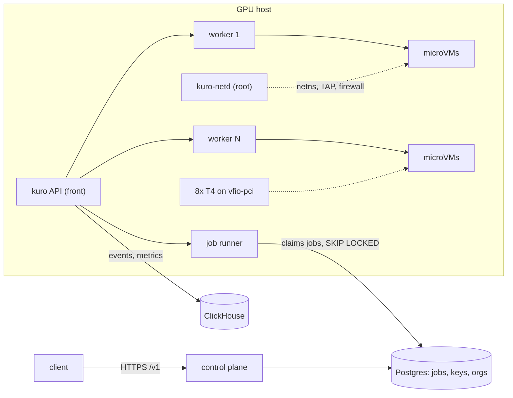
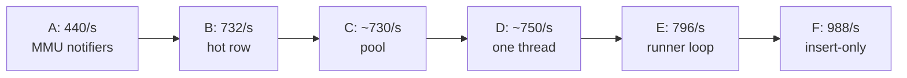

# Intro

Hey, how's it going ? Hope you're doing well. \
Last time i wrote about running Firecracker nested on a MacBook and getting 8 clones down from 160 seconds to about one ([that one is here](/blogs/firecracker-nested-restores/)).
After that i kept thinking, what if i just write the VMM myself. So i did. Its called **kuro**.

kuro is a microVM runtime in Rust on KVM. You give it code you didnt write, it runs it in its own VM with its own kernel, and if the job needs a GPU it gets a whole one. \
It went from an empty repo on Oct 24 to a host doing **1,586 jobs a second** and **26.9 GPU jobs a second on 8 T4s** about ten days later. I kept a log of every step, 23 entries of it, and this post is the whole thing squeezed into one.

<!-- TODO(briheet): a line or two in your own words on why you started it. -->

This one is very long, has a lot of tables and numbers. Grab two coffees this time :sob:

# Why write a VMM at all ?

The problem is simple to say. We run code we didnt write: jobs, agents, notebooks, model inference. Some of it needs a GPU. Any of it may be hostile. \
That code needs three things at once:

1. **A real boundary.** A tenant must not reach the host, or another tenant.
2. **Speed.** Most jobs are short. A boundary that takes seconds to set up costs more than the job itself.
3. **GPUs.** They're scarce and expensive, so they have to be shared over time without leaking between tenants.

And every usual answer gives up one of them:

| option | what you get | what you give up |
|---|---|---|
| Containers | fast | share the host's kernel, and its GPU driver with it |
| Full VMs | real boundary | boot in seconds, carry a lot of device emulation |
| Forwarding GPU calls to one driver | sharing | every tenant sits behind the same driver |
| Splitting a GPU in hardware (MIG) | sharing | only some GPUs, and needs a licence inside VMs |

So the approach is: **every job in a microVM on KVM, with as little in it as possible.**
- **Hardware isolation.** Own kernel per VM. The CPU and IOMMU enforce the boundary, not software in a shared kernel.
- **My own VMM.** Firecracker is the reference, not a fork. I reuse the rust-vmm crates (`kvm-ioctls`, `vm-memory`, `linux-loader`, `vm-superio`), but the device model, the PCI layer, the GPU device and the process model are kuro's.
- **A whole GPU, or none.** A GPU VM owns one GPU through VFIO. Between tenants, the host scrubs its memory.
- **Never boot twice.** Boot once, snapshot, restore everything else from it.
- **The host only runs work.** Keys, queues and placement live in a control plane. A GPU host runs VMs and nothing else.

# The bigger picture (architecture)

Before numbers, here is the whole thing so the rest makes sense.



- **The VMM** (`src/vmm`) runs one microVM: KVM, guest RAM, vCPUs, devices, VFIO, snapshots and resets.
- **The host API** runs many VMs on one machine over a Unix socket, spread over worker processes (why, comes later).
- **The guest** is a Linux kernel and a NixOS image, built with Nix. Every VM shares one read-only store. A small agent inside runs commands for the host over vsock.
- **The job queue** is Postgres, River and Oban style. Hosts claim jobs with `SKIP LOCKED`, only as many as they have room for.
- **Networking** goes through `kuro-netd`, a small root helper. The VMM itself runs unprivileged.

The life of a job, end to end:
1. Client sends `POST /v1/jobs` with a script, gets `202` and an id.
2. The control plane checks the key and the org's caps, inserts the job.
3. A host's runner claims it if the org has room and the host has a slot.
4. The host takes a VM from the org's pool, or restores one from the template snapshot.
5. The agent in the guest runs the script and sends back exit code and output.
6. The VM is reset to the snapshot for the org's next job. Only the pages that changed get copied back.
7. Client's `GET /v1/jobs/{id}/wait` returns.

# The setup

| layer | what |
|---|---|
| Dev | MacBook, aarch64 KVM inside a NixOS Lima VM (`kuro-dev`), so **nested virtualization**, same pain as last post |
| x86_64 before real hardware | GitHub's CI runner, which has `/dev/kvm` |
| Production host | AWS **`g4dn.metal`**: 96 vCPUs, 377 GiB, **8× NVIDIA T4**, Linux 7.0, 2 NUMA nodes |
| Guest | NixOS built with Nix, my own kernel config (`allnoconfig` plus an explicit list), `MODULES` off so an untrusted guest cant load kernel code |
| Load | k6, `perf`, `strace -T`, `pg_stat_statements`, and a lot of small samplers |

One rule i kept for the whole project: **measure first, then change one thing, then measure again.** You'll see it was wrong a lot when i didnt.

# Round 1: a blank VM to a login prompt

A VM starts with a blank CPU and empty RAM. To boot arm64 Linux, the VMM does this, in order:

| # | step | why |
|---|---|---|
| 1 | **vCPUs** | ask KVM for the host's preferred CPU type, enable **PSCI 0.2** (how Linux starts and stops CPUs); every vCPU but 0 starts powered off |
| 2 | **Interrupt controller** | KVM's in-kernel **GICv3**, created *after* the vCPUs coz KVM sizes it from them |
| 3 | **Kernel** | load the `Image` at a 2 MiB aligned base |
| 4 | **Device tree** | arm probes for nothing, so a blob describes everything: memory, CPUs, GIC, timer, UART, virtio devices, cmdline |
| 5 | **Registers** | PC = kernel entry, X0 = device tree address, EL1 with interrupts masked |

The device tree says `model = "kuro"`, so the very first proof of life is the kernel printing `Machine model: kuro`.

## It printed nothing

The first boot printed **nothing**. Instead of poking at it, i made the VMM log every step and every MMIO exit. The log showed RAM, UART, kernel, initrd, device tree and registers all set up as planned, and then... the kernel **probing my UART register by register**. So the kernel was running fine, it just wasnt talking.

The answer was sitting in my own log, in the cmdline: `loglevel=4`. NixOS's default. It keeps "Booting Linux..." off the console. Cool, an hour well spent lol.

## It booted, slowly: 22–28 seconds

Next it booted all the way to a root login on the first try. In **22–28 s**. QEMU on the same host and image took about 12 s.

| phase | kuro | QEMU |
|---|---|---|
| kernel | 4.75 s | 0.14 s |
| initrd | 8.13 s | 2.96 s |
| userspace | 13.1 s | ~3 s |

Chasing it:

**1. Memory.**
- *Theory:* guest RAM is a shared memfd, and the host had shmem huge pages off.
- *What i did:* `madvise(MADV_HUGEPAGE)`, then plain anonymous memory like QEMU.
- *Result:* **no change.** Two guesses, both wrong.

**2. Are the vCPUs idle ?**
- *What i did:* read each vCPU thread's CPU time from `/proc`.
- *Result:* **both vCPUs 80–100% busy the whole boot.** A booting guest mostly waits on I/O, it should sit in WFI using nothing. So it was trapping.

**3. Count the exits.** `perf stat` on KVM's own tracepoints over 10 s of boot:

| exit | count | what |
|---|---|---|
| stage-2 page faults | 29,197 | guest touches RAM that isnt mapped yet |
| MMIO to the VMM | 15,233 | UART bytes, virtio notifications |
| system register traps | 10,603 | registers KVM must emulate |
| WFI | 1,942 | guest going idle |

On bare metal ~4,800 exits a second is nothing. **Nested, every exit crosses two hypervisors** and costs on the order of 100–200 µs. Same disease as the Firecracker post ngl.

**The fix: hugetlbfs.** A 2 MiB page maps 512× more memory per fault than a 4 KiB one. Guest RAM became a hugetlbfs memfd. And here is the fun part, **my first attempt silently used zero huge pages**. The pool stayed full. `vm-memory` maps with `MAP_NORESERVE`, so nothing was reserved upfront, and if the pool runs dry later hugetlbfs answers the guest's next page touch with **SIGBUS**, which kills the VMM. Fix is to `fallocate` the whole memfd when the VM is built, so the pages are guaranteed or the build fails with a clear error.

| phase | 4 KiB pages | hugetlbfs 2 MiB |
|---|---|---|
| kernel | 4.7 s | **0.13 s** |
| initrd | 7.7–8.1 s | **2.6 s** |
| userspace | 9.2–13 s | **2.5 s** |
| boot to login | 22–28 s | **6.4–6.6 s** |

Plus a bunch of guest trims: `dhcpcd` waiting 30 s for a NIC that doesnt exist, vconsole setup with no virtual terminal, timesyncd, oomd, yade yade yada.

## 6.6 s to 1.7 s: two systemd timeouts

At this point the VMM part was ~11 ms. The other 5 seconds were systemd. What is it doing for 5 seconds ?

**Timeout 1: systemd asks the console its size.** The console log started with escape sequences nobody asked for:

```
ESC P+q6E616D65 ESC\     what terminal are you?
ESC[18t                  how big are you?
ESC[6n                   where is the cursor?
```

systemd waits **333 ms per query** for an answer. My console is a 16550 UART with a log file behind it. Nothing ever answers :sob:. It does this in the initrd, again after switch root, and agetty does it too. Known issue ([systemd#43735](https://github.com/systemd/systemd/issues/43735)), the fix is `systemd.tty.term.console=dumb`. Login: **6.6 s → 3.3 s.**

**Timeout 2: 5 mounts a second.** The journal had two quiet gaps of ~0.9 s before plain tmpfs mounts. Sampling every vCPU every 100 ms showed the guest doing *nothing* in the gaps. No CPU, no disk. So, a timer. I ruled out the VT, the vCPU count and udev, then went to read systemd's `src/core/mount.c`:

```c
/* Let users override the default (5 in 1s), as it stalls the boot sequence on busy systems. */
```

systemd rate limits the mount table watcher to 5 events a second, and my boot mounts more than 5 things in its first second. Twice. The override is an env var of PID 1, and the kernel passes unknown `KEY=value` cmdline options to init as env. So, one more cmdline option: `SYSTEMD_DEFAULT_MOUNT_RATE_LIMIT_BURST=100`.

| | before | after |
|---|---|---|
| 1 VM: request → root login | 6.6 s | **1.7 s** |
| systemd total | 5.4 s | **1.2 s** |
| 4 VMs at once, all logged in | 7.7 s | **2.6 s** |

28 s to 1.7 s, still nested on a Mac. Pretty happy with this one.

# Round 2: x86_64 on a machine i dont have

Production is x86 (`g4dn.metal`), dev is an arm Mac. So the x86 boot (CPUID, MSRs, the local APIC, long mode, port I/O as a second bus, shutting down without ACPI) was written on the Mac, checked with clippy for the other target, and run on **GitHub's CI runner, which has `/dev/kvm`** for free.

Two things i'd tell anyone doing this:
- **Copy the boot protocol, not someone's VMM.** The kernel's `boot.rst` lists exactly what must be true at the 64 bit entry. Each line became one small step.
- **A compressed kernel is bigger than its file.** Place things above `init_size`, not above the file's end. Took me a while ngl.

# Round 3: devices, and the bugs they hid

Short version, coz each of these was its own log entry:

| piece | before → after |
|---|---|
| MMIO bus dispatch | **432 ns → 8 ns** |
| virtio devices off the vCPU thread | a pool of event loops (ioeventfd), so a vCPU never does disk work |
| vsock, guest → host | **~100 MiB/s → ~0.85 GiB/s**, userspace device, not the kernel's vhost-vsock |
| virtio-net on a TAP | **259 → ~3,800 MiB/s** with offloads |
| VM registry | lock-free B+tree, built for 100,000 VMs |

Why userspace vsock: the kernel's vsock code has a rough record, and CIDs are host-wide, so any host process can `connect()` to any guest's listening port. In userspace each VM gets a Unix socket and its own CID space.

The vsock speedup came from reading Firecracker's source instead of trusting a summary: credit updates only when the guest thinks less than 4 KiB is left (not every 4 KiB), a bigger window (nested round trips are ~300 µs, so a 64 KiB window caps you near 200 MiB/s), and `EVENT_IDX`.

Most of the time in this round went into **fuzzing, Kani proofs and tests**, and they found **seven bugs**. My favourite: bigger socket buffers made the guest split one vsock packet over three descriptors (`[44, 32768, 32768]`), and the rust-vmm crate only accepts a header plus one data buffer. So the connection just... stalled. No error. Tests passed lol.

# Round 4: a whole T4 in a microVM

Then the real host. `g4dn.metal`, 8 T4s, VFIO code meeting a GPU for the first time.

**The host was better than feared.** The IOMMU was already on, each T4 has its own IOMMU group (so 8 GPU VMs per host, not 4), and a bus reset brings a T4 back **100 of 100 times**.

Except... **my first reset test failed all 100 rounds.** Config space fine, but BAR0 read `0xffffffff`, like a dead GPU. It wasnt dead. vfio-pci puts a device nobody has open into **D3hot**, and a device there answers memory reads with all ones. Holding it in D0 (`power/control=on`) and all 100 passed, ~180 ms each. An idle device can look dead, check its power state first.

First contact from inside the guest:

```
kuro-gpu: Tesla T4, 14911 MiB, 14806 MiB free
kuro-gpu: vector-add ok, 1048576 elements
```

`kuro-gpu` is a tiny C program that loads libcuda at run time with PTX kernels, so the guest needs no CUDA toolkit at all, just the driver.

**`nvidia-smi` segfaulted**, and it wasnt me. Error 7 in `ld-linux`, a write to a read-only page, before `main`. It crashed on the host too. NixOS's `patchelf` had moved its `.dynamic` section into a read-only segment, and the loader writes `.dynamic` at start. The GPU image now ships a copy with that one segment flag flipped.

## Who clears the VRAM ?

A VM owns the GPU's whole 15 GB of VRAM. The next tenant must not see any of it. The plan was a trusted scrub VM, research changed that:
- **A VM cant be trusted to clear anything.** Its driver is under the guest's control. The host has to do it.
- **The firmware already does.** After a reset, Turing's firmware clears VRAM and sets a bit when done.

I didnt take the bit's word for it. The residue test is built to be mean:
1. VM A fills all the VRAM it can get, 14,804 MiB, with a canary, and **holds it**.
2. The host kills VM A. Its driver never frees anything.
3. VM B scans all the VRAM it can get.

```
kuro-gpu: scanned 14803 MiB: 0 words of c0ffee5eed5a1e00, 0 nonzero words
```

Not a single nonzero word. Then the API learned GPU slots: `free → leased → scrubbing → free` (or `broken` if a scrub fails). 8 VMs leased all 8 T4s, a 9th got a 503.

# Round 5: a thousand microVMs on one host

Now fill the host until it says no. k6 against the host API, plus `perf record -g`, `strace -T`, and a 1 s sampler on the API process.

**1. Six bus resets per GPU lease.** Create took 565 ms and delete 945 ms, and `perf` showed *no CPU* behind it. `perf` shows work, not waiting. `strace -T` showed it in one run:

| call | when | time |
|---|---|---|
| `VFIO_GROUP_GET_DEVICE_FD` | open: the kernel resets the GPU | 207 ms |
| `VFIO_DEVICE_RESET` | then i reset it again | 183 ms |
| `VFIO_DEVICE_RESET` | VM goes: i reset it | 172 ms |

Plus the kernel's own reset on close, plus the scrub's open, reset and close. **Six resets for one lease**, two of them mine and useless. Also an `ERROR ... Device or resource busy` on every teardown: Rust drops struct fields in order, and the VFIO device was declared first, so it closed while its BAR mappings still held it. Moved one field to the bottom. Fixed :)

**2. One event loop, one core.** First CPU profile was basically one line: **94% of the API's CPU in `event-loop-0`**, the kernel copying store disk reads into guest RAM. Default was one loop. Now its one per 4 host cores.

**3. Huge pages, one VM at a time.** One VM builds in 15 ms, but with 16 in flight create was 650 ms. `fallocate` was zeroing each VM's pages *under a process-wide lock* (the lock exists so two VMs cant each take half of what's left and both fail). Trick: a shared mapping of a hugetlbfs memfd reserves all its pages at once or fails with `ENOMEM`, and the reservation outlives the mapping. So reserve under the lock, zero lazily outside it.

| | lock around zeroing | reserve only |
|---|---|---|
| Create p50, 200 VMs, 16 at once | 655 ms | **121 ms** |
| Boot to login p50, 1,093 VMs | 16.5 s | **12.6 s** |

**4. How many fit ?**

| | |
|---|---|
| VMs running at once | **1,093** |
| Why not 1,094 | the huge page pool: 140,000 pages is 1,093.75 VMs of 256 MiB. The API said so in its 500 |
| The API, per VM | ~55 KiB RSS, 2 threads, 8 fds |
| 1,093 idle VMs | 4% of one core, in total |

A thousand microVMs on one box, and the limit was the one i expected and it told me clearly. One more was hiding: the shell's default of 1,024 open files would have stopped the API near 120 VMs lol.

# Round 6: snapshots, and the one-process wall

A boot costs ~3.8 core-seconds in a storm. A snapshot restore skips all of that:

| | |
|---|---|
| Take a snapshot (256 MiB, booted) | 152 ms |
| One clone, restored and started | **4–5 ms** (a boot: 2 s) |
| Host memory per clone | ~2 MiB, shares the template |
| 2,000 clones | 17.6 s, **114 a second** |

114 a second felt low for a 5 ms restore. And it got worse the more VMs were running:

| VMs already running | restore |
|---|---|
| 0–100 | 6 ms |
| 1,000 | 142 ms |
| 2,000 | 360 ms |

Chasing it:
- *NUMA balancing off:* restores grew just the same. Not it.
- *Copy RAM into private huge pages, no copy-on-write:* still grew. Not the main cause.
- *Halt polling off, `nx_huge_pages` off, guest timer flags:* noise.

**What it actually was:** every restore phase maps or unmaps memory (RAM, the pmem slot, each vCPU's `kvm_run`). A mapping change takes the **process's memory lock for writing**, and waits for every page fault of every running VM in that process. All my VMs lived in one process. So VM number 2,000 waited on the faults of the other 1,999.

**The fix: worker processes.** The API becomes a front, starts N copies of itself, and routes each `/vms/{id}` to its worker. Snapshots are files, so any worker restores any snapshot.

| | one process | 16 workers |
|---|---|---|
| Restore p50, 2,000 clones | 245 ms | **4.8 ms** |
| Restore, 0 → 2,000 VMs | 6 → 360 ms | **3 → 5 ms** |
| Clones a second | 114 | **964** |
| Boots a second | 27 | **113** |

Woh. Flat at 3–5 ms however many VMs are running.

# Round 7: GPU VMs in milliseconds

A GPU VM took ~2.9 s to be ready. Where it went:

| step | time |
|---|---|
| Build: VFIO opens the T4 (a reset, ~180 ms), 1 GiB pinned for DMA (155 ms) | 0.38 s |
| Guest kernel and initrd | 0.61 s |
| NVIDIA module loads, the GPU's GSP firmware boots | 0.82 → 2.29 s |
| `nvidia-persistenced` holding up boot | 1.0 s |
| GPU answers | **2.9 s** |

The GSP firmware takes ~1.2 s whatever the host does. When the device's own boot is the floor, **do it before the request**. So: keep the GPU open in a held VFIO container (no reset per open/close), make RAM ahead, and keep warm VMs booted.

| one T4 GPU VM | before | after |
|---|---|---|
| Lease a VM, GPU ready | ~2.9 s | **7–11 ms** (warm) |
| Build a VM | 376 ms | **12–13 ms** |
| Delete | 222 ms | **47 ms** |
| VRAM scrub | ~600 ms, 3 resets | **180 ms**, 1 reset |

Also: precompiling the CUDA kernels to sm_75 would have needed NVIDIA's whole toolkit in the build to save... 20 ms. Measured before building it, and didnt.

# Round 8: jobs a second, through the real API

Until now i was hitting the host API directly. Now the whole path: `/v1`, control plane, Postgres queue, runner, VM. One k6 test steps CPU jobs up every minute (each job runs `true` in a VM restored from the template), with sandboxes (create, one exec, held 30 s) alongside. Rate limits off, so the host is the limit and not a setting.

The surprise of the whole project: **until the very last step, the host was a third to half idle.** Every limit was a wait, not work. Six of them, one after the other:

**1. KVM's MMU notifiers. Run A: 440 a second.**
- *What i saw:* at the 800 step, 28% idle. vCPU threads at 55%, top symbols `_raw_spin_lock` 10.8%, SRCU 8%, `kvm_mmu_notifier_invalidate_range_*`.
- *Why:* a clone maps the template `MAP_PRIVATE`. Its first write to a page is a copy-on-write, and that fires an MMU notifier. **The notifier belongs to the process, not the VM.** So every VM in the worker gets called and searches its memslots, for a page that isnt theirs. NUMA balancing does the same thing with its scans (cloud-hypervisor saw it too, [#7574](https://github.com/cloud-hypervisor/cloud-hypervisor/issues/7574)).
- *What i did:* 48 workers instead of 16, each bound to its NUMA node, so balancing skips them.
- *Result:* `_raw_spin_lock` 10.8% → **1.25%**, vCPU threads 55% → **26%**.

**2. One hot row in Postgres.**
- *What i saw:* `UPDATE projects SET queued = queued + 1 ...`, 81,079 calls, 3.96 ms mean. Every submit took that one row's lock and held it through its commit's WAL flush. One project tops out near 440 a second, right where it stopped.
- *What i did:* `synchronous_commit = off` on those pools. A row lock now lasts microseconds. A crash can lose the last ~0.6 s of writes, and every one of them is retried by someone.
- *Result:* **Run B: 732 a second.**

**3. The connection pool.**
- *What i saw:* `SELECT 1 FROM orgs WHERE id = $1 FOR NO KEY UPDATE` on sandbox create, **216 ms mean, 7,887 s total** in a 9 minute run. ~15 connections stuck waiting at any time, so the pool of 64 ran dry: 426,333 "slow acquire" warnings.
- *What i did:* no org lock on creates, API keys cached for 5 s (hash still checked every time), pool 128.
- *Result:* sandboxes 3× faster. **Jobs still ~730.** Hmm.

**4. One thread.**
- *What i saw:* live, at the 1,200 step: 6,510 jobs queued, **26 running**, 2,000 slots free. `top -H`: the control plane's `control` thread at **90% of one core.** My `block_on` helper built a `new_current_thread` runtime, so the whole control plane ran on one thread :sob:
- *What i did:* a multi-thread runtime for the control plane and the API front. (First release build failed coz tokio's `rt-multi-thread` was only on through a test dependency, and `just build` piped cargo into `tail`, so the stack started on the *old* binary. Fun.)
- *Result:* submits and sandboxes **10–40× faster**. Jobs... didnt move. Each claim returned **0.73 jobs**.

**5. The runner's loop.**
- *What i saw:* the loop took one event per pass, a new job notice (~1,000 a second) or one finished job, and every pass also claimed. Finished jobs piled up faster than one a pass, their slots stayed taken, so each claim asked for one or two jobs.
- *What i did:* take every finished job first, and never claim with no slot free.
- *Result:* **796 at the 800 step**, job p95 under a second. Past 800 it collapsed though.

**6. Foreign keys.**
- *What i saw:* Postgres waits: `LWLock: MultiXactOffsetSLRU` × 79 sessions, `Lock: tuple` × 34. Every insert into `jobs` checks its foreign key with `SELECT ... FOR KEY SHARE` on the project's and org's row. Many transactions sharing a lock on one row make a MultiXact, its cache is small, and everyone waits on it. Host 65% idle.
- *What i did:* rewrote the job tables so the hot path **never updates a row**. `jobs` is inserted once. `job_queue` and `job_running` are insert then delete. `job_events` is append only, and a job's state is its latest event. No foreign keys, no triggers, no `NOTIFY`.
- *Result:* **Run F: 988 a second**, job p95 under a second, Postgres never waited on a lock and used 4–9% of the host.



And now, finally, the host itself is the limit. At 1,000 a second, **half of its CPU goes to making and destroying a VM per job.**

# Round 9: the cheapest VM is the one you already have

So stop destroying them. A CPU job now runs in a VM its org used before, **reset** to the template between jobs:

1. Pause the vCPUs and devices.
2. Copy back every page written since the last reset, from a read-only mapping of the template.
3. Restore each vCPU's state, the interrupt controllers, the clock.
4. Reset each device to its saved state.
5. A new `VMGenID`, so the guest kernel reseeds its RNG.
6. Resume.

The copies land on pages the VM already owns. No page fault, no remap, so **no MMU notifier and no TLB shootdown**.

Which pages changed has two writers. The guest, which KVM logs per memory slot (Intel's PML does it without an exit per page). And my own devices, writing into guest buffers through the host mapping, which KVM doesnt see. Every device write passes through one function, `QueueDrain::run`, so it marks them in a bitmap there. A whole buffer is marked, written or not. A page too many is safe, one too few isnt.

**Proving it forgets.** A KVM test restores a clone, writes a random secret into `/dev/shm` (guest writes) and echoes it over vsock (device writes), checks the secret is in guest RAM, resets, then **scans all of guest RAM for it. None.**

| | fresh VM | reused |
|---|---|---|
| Getting a VM | 4.8 ms (restore) | **0.001 ms** |
| The command | 25 ms | **7.7–8.1 ms** |
| Reset after | – | **1.7–1.9 ms** |

A reused VM only ever serves **one org**. Across orgs it would also need a branch predictor barrier at the switch, and thats not done yet.

| CPU jobs/s asked | done/s (F → **G**) | job p95 (F → **G**) |
|---|---|---|
| 1,000 | 988 → **1,000** | < 1 s → **< 1 s** |
| 1,200 | 689 → **1,198** | 14 s → **< 1 s** |
| 1,600 | 394 → **1,584** | 38 s → **< 1 s** |

At 1,000 a second the VMs' kernel side CPU fell from **46% to 12%** of the host, and the host went from 25% idle to **55%**. The org's pool held 25 VMs at 1,000 a second. Not one per job, just as many as run at once. Holy moly.

# Round 10: GPU jobs, 2.1 to 26.9 a second

Same idea for GPUs. A fresh VM per GPU job did **2.13 jobs a second** on 8 T4s, coz 85% of each GPU's time went to setup: boot, CUDA's first start, destroy, scrub.

**Warm VMs didnt help.** I tried 8 warm GPU VMs first: 2.06 a second. A warm VM serves one tenant then goes, and its replacement boots on that GPU before the GPU takes another job. At full load each GPU still pays a boot per job. **Warm VMs make one job fast, they dont add jobs a second.**

And a GPU VM cant be *reset* like a CPU one. There is no snapshot of a VFIO device (Firecracker and Cloud Hypervisor dont do it either), and the NVIDIA driver keeps state on the card that restoring RAM wouldnt restore. So a GPU VM is **kept, not reset**: after a job the guest kills anything still on the GPU and wipes `/tmp`, `/var/tmp`, `/dev/shm`, then waits for the same org's next job. Idle 60 s, it goes and its GPU is scrubbed.

| | fresh VM | warm VMs | reuse | reuse, one `nvidia-smi` |
|---|---|---|---|---|
| GPU jobs done/s | 2.13 | 2.06 | 25.0 | **26.9** |
| Failed | 0 | 0 | 0 | **0** |
| Getting a VM, p50 | 222 ms | 1 ms | 0 ms | **0 ms** |
| The command, p50 | 3,108 ms | 389 ms | 272 ms | **269 ms** |
| After the job, p50 | 55 ms | 58 ms | 44 ms | **26 ms** |

The last column is literally running `nvidia-smi` once instead of twice in the cleanup (~20 ms each). 8 GPUs ÷ (269 + 26 ms) ≈ 27 a second. **The GPUs are the limit now, not the host.**

Same round, the worker processes got jailed: **seccomp** with 83 syscalls (found with `strace -f -c` under the tests and a mixed load, anything else kills the process), and **Landlock** (write only under kuro's dirs and `/dev`, execute nothing). Under a 31,728 job mixed load with seccomp set to log, it logged nothing. Then every run above ran with kill on, and at 1,000 jobs a second the host was still 64% idle (55% before, the NUMA policy changed in the same round too).

# What the numbers say

**1. Count before you fix.** Two memory fixes did nothing for the slow boot; one `perf stat` of exits showed the answer. Five GPU resets were invisible to `perf` and obvious in one `strace -T`.

**2. Most limits were waits, not work.** From 440 to 988 jobs a second the host sat a third to half idle. A hot row, a pool, one thread, a loop, a lock cache. Profiles of CPU dont show any of that.

**3. Per-process kernel state is shared state.** The mmap lock and the MMU notifier both belong to the process. Hundreds of VMs in one process pay for each other. Worker processes were the fix twice.

**4. The cheapest VM is the one you already have.** A reset is a page copy, a new VM is a page fault per page.

**5. Dont trust anything to clean up.** Not the guest, not the firmware's done bit. Kill it mid job and scan what's left.

# Recommendations

If you are building something like this, here is the tldr:

- **Guest RAM:** hugetlbfs, reserved with a shared mapping (or `fallocate`), never `MAP_NORESERVE` alone. Thats a SIGBUS waiting to happen.
- **Guest boot:** `systemd.tty.term.console=dumb` and `SYSTEMD_DEFAULT_MOUNT_RATE_LIMIT_BURST=100` if your console is a UART. 5 seconds for free.
- **Many VMs:** dont put them all in one process. Split into worker processes, bind each to a NUMA node.
- **Restores:** snapshot once, restore everything else. Reset between jobs of one tenant instead of destroying.
- **GPUs:** count your resets, keep the device open, boot ahead. Scrub on the host, and test the scrub with a guest that never frees.
- **Queues in Postgres:** keep the hot path insert-only. No foreign keys, no counters on a shared row.

# Bugs i hit along the way (so you dont)

- **`pkill -f <pattern>` can kill the shell running it**, coz the shell's own command line matches. Did it twice. Use `pkill -x <name>`.
- **A test that never iterated can pass.** A k6 GPU test crashed in setup, and its thresholds said ✓ with zero checks. Now it needs `iterations > 0`.
- **An idle PCI device reads all ones** in D3hot. Looks exactly like a dead GPU.
- **Rust drops fields in declaration order.** A VFIO device declared first closed before its BAR mappings.
- **perf's precise cycles event doesnt sample guest time.** "72% in the kernel" was 72% of *host side* samples, a small part of the machine. A plain 96 VM run answered in 7 minutes what three perf guided experiments couldnt.
- **`${loops:+env ...} KURO_HOST_GPUS= ...`** makes bash run `KURO_HOST_GPUS=` as a command when `loops` is empty. Lost a run to that one lol.
- **`MPOL_BIND` OOM-kills a worker when its node is full**, even with the other node half empty. `MPOL_PREFERRED` falls back.

# Numbers

One `g4dn.metal`: 96 vCPUs, 377 GiB, 8× T4, Linux 7.0. Through the public API, each job in its own microVM.

| CPU microVMs | |
|---|---|
| Jobs finished a second | **1,586** |
| Job p95, up to 1,600 a second | < 1 s |
| Reset a VM between jobs | 1.7–1.9 ms |
| Restore a clone from a snapshot | 4–5 ms |

| GPU microVMs (a whole T4 each) | |
|---|---|
| GPU jobs finished a second, 8 T4s | **26.9** |
| A GPU job on a kept VM, p50 | 0 ms to get the VM, 269 ms CUDA `vector-add`, 26 ms cleanup |
| Warm GPU VM lease | 7–11 ms |
| VRAM scrub between orgs | 180 ms |

# End notes

Ten days, a VMM, a control plane, and a lot of tables. Whats next:
- **A jailer:** a process per VM, in a chroot and its own namespaces.
- **Files through the agent**, and **snapshots with net**.
- **Admission by memory.** A full host thrashes until SSH stops answering instead of refusing new VMs. Found that the hard way at 2,400 jobs a second.
- **Real GPU work.** `vector-add` is small. PyTorch, model loading, and maybe restoring a loaded model with cuda-checkpoint.
- **Reuse across orgs**, with a branch predictor barrier at each switch.
- **H100 passthrough.**

<!-- TODO(briheet): repo link here once it's public. -->

If you have any queries, or have built something similar, please reach me out through X, discord or wherever you want. Happy hacking.

## Sources and further reading

- Firecracker: [Click me](https://github.com/firecracker-microvm/firecracker)
- rust-vmm crates: [Click me](https://github.com/rust-vmm)
- Cloud Hypervisor, NUMA balancing and MMU notifier unmaps: [Click me](https://github.com/cloud-hypervisor/cloud-hypervisor/issues/7574)
- systemd asking a dumb console its size: [Click me](https://github.com/systemd/systemd/issues/43735)
- The Linux x86 boot protocol: [Click me](https://www.kernel.org/doc/html/latest/arch/x86/boot.html)
- NVIDIA gpu-admin-tools: [Click me](https://github.com/NVIDIA/gpu-admin-tools)
- River, the Postgres job queue style kuro's queue follows: [Click me](https://riverqueue.com)
